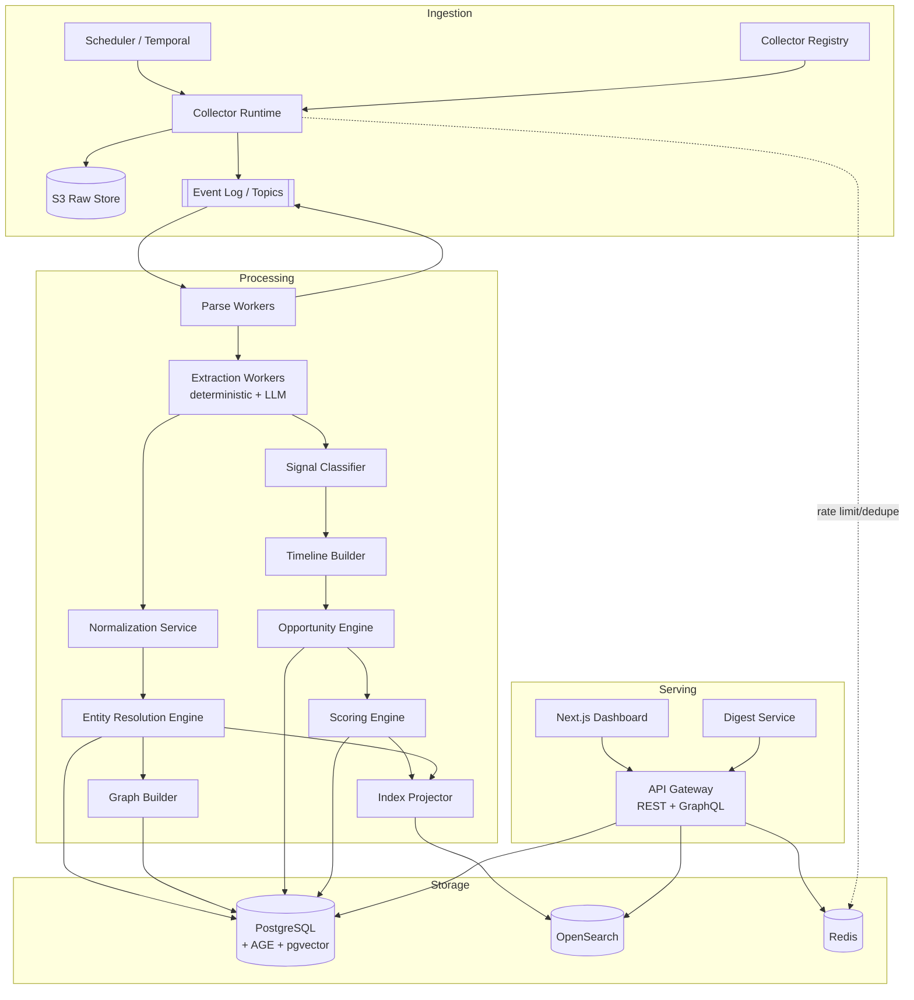

# Opportunity Intelligence Platform (OIP)
## Software Architecture Document (SAD)

> **Codename:** NavIC
> **Author:** Founding CTO / Staff Architect
> **Status:** Baseline v1.0 — Implementation-Ready Blueprint
> **Audience:** Senior/Staff engineers implementing the platform
> **Companion documents:** [`schema/schema.sql`](./schema/schema.sql) · [`FOLDER_STRUCTURE.md`](./FOLDER_STRUCTURE.md) · [`ROADMAP.md`](./ROADMAP.md)

---

## Table of Contents

1. [Executive Summary](#1-executive-summary)
2. [Product Vision](#2-product-vision)
3. [Functional Requirements](#3-functional-requirements)
4. [Non-Functional Requirements](#4-non-functional-requirements)
5. [System Architecture](#5-system-architecture)
6. [Component Diagram](#6-component-diagram)
7. [Service Architecture](#7-service-architecture)
8. [Folder Structure](#8-folder-structure)
9. [Database Design](#9-database-design)
10. [Knowledge Graph Design](#10-knowledge-graph-design)
11. [Entity Resolution](#11-entity-resolution)
12. [Opportunity Engine](#12-opportunity-engine)
13. [Collector Framework](#13-collector-framework)
14. [Processing Pipeline](#14-processing-pipeline)
15. [Ranking Engine](#15-ranking-engine)
16. [Search Architecture](#16-search-architecture)
17. [API Design](#17-api-design)
18. [Background Workers](#18-background-workers)
19. [Scheduler Design](#19-scheduler-design)
20. [Caching](#20-caching)
21. [Deployment Architecture](#21-deployment-architecture)
22. [Monitoring](#22-monitoring)
23. [Logging](#23-logging)
24. [Testing Strategy](#24-testing-strategy)
25. [Security Considerations](#25-security-considerations)
26. [Scalability Strategy](#26-scalability-strategy)
27. [Future SaaS Migration Strategy](#27-future-saas-migration-strategy)
28. [Technical Risks](#28-technical-risks)
29. [Development Milestones](#29-development-milestones)
30. [6-Month Roadmap](#30-6-month-roadmap)

---

## 1. Executive Summary

The Opportunity Intelligence Platform (OIP) is a **continuously-running knowledge system** that discovers publicly-available buying signals across the internet and converts them into ranked, evidence-backed business opportunities. It is **not** a scraper, an email finder, or an Apollo clone. Those products treat the web as a lookup table. OIP treats the web as a **stream of events that mutate a living knowledge graph** of people, companies, and the relationships between them.

The core architectural thesis is threefold:

1. **Everything is an entity with evidence.** No attribute exists in the system without a provenance chain (source, URL, date, collector, confidence). This is the single most important invariant. It is what separates an intelligence platform from a scraper: every claim is falsifiable and auditable, and conflicting claims are resolved by evidence weight rather than last-write-wins.

2. **Enrichment, never replacement.** Data is append-only at the observation layer. Canonical entity state is a *projection* computed from all observations via deterministic survivorship rules. A crawl six months from now can upgrade a Bronze company to Gold without destroying the history of how it got there. Re-computability is a first-class design goal.

3. **The pipeline is a directed acyclic transformation of immutable layers.** Raw HTML → Parsed → Normalized → Resolved Entities → Graph Edges → Opportunities. Each layer is independently storable, replayable, and reprocessable. If we improve the entity extractor, we replay from the Parsed layer without re-crawling the internet.

The system classifies opportunities into three maturity tiers — **Gold** (person + company + domain + role + evidence + signal), **Silver** (company + domain + signal + inferred department/role), and **Bronze** (company + domain + weak signal) — and continuously promotes leads up the ladder as evidence accumulates.

**Deliberate non-goals for v1:** authentication, billing, multi-tenancy, subscriptions, Stripe, enterprise RBAC. There is exactly one user. Every hour spent on those is an hour not spent on data quality. However — and this is a critical architectural stance — **the data model and service boundaries are designed so that multi-tenancy is an additive migration, not a rewrite** (see §27). We do not build tenancy; we do not preclude it.

**Recommended starting stack** (justified throughout, with explicit scale-up paths): Python for collectors/pipeline (ecosystem for parsing/NLP/ML), PostgreSQL 16 as the canonical system-of-record (with `pgvector`, `pg_trgm`, and Apache AGE for in-database graph traversal), Redis for cache + rate-limiting + ephemeral queues, a durable message log (start with **Redis Streams / NATS JetStream**, graduate to **Kafka/Redpanda** at volume), OpenSearch for search, S3-compatible object storage for the immutable raw layer, and a Next.js/React internal dashboard. Orchestration via a code-first scheduler (**Temporal** recommended; Prefect/Dagster acceptable) rather than cron-in-a-box.

This document specifies each of these decisions with the reasoning, the schema, the interfaces, and the migration path, at a level a senior engineering team can implement directly.

---

## 2. Product Vision

### 2.1 The problem

Buying intent is broadcast publicly every day and almost entirely wasted. A company that just raised a Series A, posted three "RevOps" job listings, published a blog post complaining about their CRM's deliverability, and whose VP of Sales spoke at a conference about "scaling outbound" is *screaming* that it is in-market for specific tooling. That signal is scattered across a funding database, a careers page, a company blog, a conference agenda, and a LinkedIn post. No human connects them. Existing tools sell you a static contact list; they do not sell you **the narrative of a company's needs over time**.

### 2.2 The product

OIP builds and maintains, for every entity it discovers, a **timeline of signals** and a **graph of relationships**, and surfaces the moments where those combine into an opportunity. The unit of value is not a contact record — it is an **evidence-backed opportunity**: *"Acme (acme.com) is likely in-market for a CRM because they raised a seed round in January, have been hiring SDRs and RevOps since February, and their Head of Growth publicly asked about CRM migration on Hacker News in March. Suggested decision maker: VP Sales / Head of RevOps."*

### 2.3 Who it is for (today: one operator)

The current user is the operator/founder. The product must let that one person:
- Wake up to a **daily digest** of newly-discovered and newly-upgraded opportunities.
- **Filter** by Gold/Silver/Bronze, industry, signal type, technology, freshness.
- **Search** semantically and structurally ("companies hiring SDRs that mention HubSpot").
- **Explore the graph** — click a company, see its people, signals, timeline, and the evidence behind every claim.
- **Trust** every data point because it links to its source.
- **Tune** the system — add keywords, sources, and scoring weights — without engineering help.

### 2.4 North-star metrics

| Metric | Definition | Why it matters |
|---|---|---|
| **Gold opportunities / week** | New + upgraded Gold leads surfaced | Direct output value |
| **Promotion rate** | % of Bronze→Silver→Gold transitions / month | Proves the enrichment flywheel works |
| **Evidence density** | Avg. distinct sources per claimed attribute | Data-quality proxy |
| **Freshness** | Median age of signals on surfaced opportunities | Intent decays fast; stale = worthless |
| **Precision@Gold** | Operator-rated correctness of Gold leads | Guards against confident-but-wrong |
| **Coverage** | Distinct companies/people under active tracking | Graph growth |

### 2.5 Long-term vision

A knowledge graph large enough (100M+ people, 10M+ companies, billions of evidence records) that it becomes a defensible data asset — the substrate for a future SaaS where the intelligence, not the access, is the product.

---

## 3. Functional Requirements

Requirements are grouped and tagged `FR-<area>-<n>`. **MUST** = v1, **SHOULD** = near-term, **MAY** = later.

### 3.1 Discovery & Collection
- **FR-COL-1 (MUST):** Support pluggable collectors that discover entities and signals from arbitrary public sources; adding a collector must require **zero changes to core**.
- **FR-COL-2 (MUST):** Every collector implements a uniform lifecycle: `discover → fetch → parse → normalize → emit`, with built-in retry, checkpointing, rate-limiting, logging, and recovery.
- **FR-COL-3 (MUST):** Persist the **raw response** (HTML/JSON/bytes) immutably before any parsing.
- **FR-COL-4 (MUST):** Respect `robots.txt`, per-host politeness, and per-source rate limits.
- **FR-COL-5 (SHOULD):** Support incremental/delta collection (ETag/Last-Modified/cursor) so re-crawls are cheap.
- **FR-COL-6 (SHOULD):** Support seed expansion — a discovered domain triggers discovery of its careers page, blog, team page, etc.

### 3.2 Extraction & Normalization
- **FR-EXT-1 (MUST):** Extract candidate entities (people, companies, domains, jobs, posts, events, products, technologies) and candidate signals from parsed content.
- **FR-EXT-2 (MUST):** Attach an `Evidence` record to every extracted claim.
- **FR-EXT-3 (MUST):** Normalize company names, person names, domains, roles, locations, and technologies to canonical forms.
- **FR-EXT-4 (SHOULD):** Use an LLM extraction path (Claude) for unstructured text, gated behind a deterministic pre-filter to control cost.

### 3.3 Entity Resolution
- **FR-ER-1 (MUST):** Merge multiple observations of the same person/company into one canonical entity via deterministic + probabilistic matching.
- **FR-ER-2 (MUST):** Never destroy source observations on merge; canonical state is a projection.
- **FR-ER-3 (MUST):** Support **un-merge** (split) when a merge is later found wrong.
- **FR-ER-4 (MUST):** Record match confidence and the features that drove each merge decision.

### 3.4 Knowledge Graph
- **FR-KG-1 (MUST):** Model typed, directed, evidence-backed relationships between entities (works_at, uses, hiring_for, raised, mentions, spoke_at, authored, competitor_of, …).
- **FR-KG-2 (MUST):** Support traversal queries (neighbors, paths, subgraphs) for the graph explorer.
- **FR-KG-3 (SHOULD):** Support temporal edges (relationship valid_from/valid_to) for historical tracking.

### 3.5 Signals, Timeline & Opportunities
- **FR-OPP-1 (MUST):** Detect and classify buying signals (funding, hiring, tech adoption/churn, product launch, pain-point mention, expansion, leadership change).
- **FR-OPP-2 (MUST):** Maintain a per-company chronological **timeline** of signals and events.
- **FR-OPP-3 (MUST):** Generate Opportunities classified Gold/Silver/Bronze per the specified rules.
- **FR-OPP-4 (MUST):** Continuously **promote/demote** opportunities as evidence changes; record every transition.
- **FR-OPP-5 (SHOULD):** For Silver, infer suggested department and decision-maker role from signal + firmographics.

### 3.6 Scoring & Ranking
- **FR-SCORE-1 (MUST):** Compute multiple independent scores (Identity Confidence, Company Confidence, Buying Intent, Evidence, Freshness, Relationship, Timeline) and a composite Opportunity Score.
- **FR-SCORE-2 (MUST):** Scores must be explainable — each is a documented function of stored features.
- **FR-SCORE-3 (SHOULD):** Weights are configurable at runtime without redeploy.

### 3.7 Search & UI
- **FR-UI-1 (MUST):** Dashboard filterable by Gold/Silver/Bronze/All and by facets (industry, signal, tech, freshness).
- **FR-UI-2 (MUST):** Structured + full-text search ("companies hiring SDR", "companies using HubSpot", "people discussing deliverability").
- **FR-UI-3 (MUST):** Entity detail pages (Company, Person, Opportunity) showing timeline, evidence, relationships.
- **FR-UI-4 (MUST):** Graph explorer (interactive neighborhood view).
- **FR-UI-5 (MUST):** Operator pages: Collectors status, Jobs, Keyword Management, Scoring weights, Settings.
- **FR-UI-6 (SHOULD):** Semantic search over evidence text (vector).

### 3.8 Operations
- **FR-OPS-1 (MUST):** Every collector run, pipeline stage, and job is observable (status, throughput, errors, lag).
- **FR-OPS-2 (MUST):** Full replay: reprocess any layer from stored raw/parsed data without re-crawling.
- **FR-OPS-3 (SHOULD):** Data lineage view — for any attribute, show the chain from raw doc to canonical value.

---

## 4. Non-Functional Requirements

| # | Attribute | Requirement | Rationale |
|---|---|---|---|
| NFR-1 | **Data durability** | Raw layer 11-nines (object store); DB PITR ≤ 5 min RPO | Raw data is irreplaceable; re-crawling is expensive & sometimes impossible |
| NFR-2 | **Reprocessability** | Any transform layer replayable from the layer below | Algorithms will improve constantly |
| NFR-3 | **Idempotency** | Every pipeline stage idempotent on `(source, content_hash)` | Retries and replays must not double-count |
| NFR-4 | **Scalability** | Design for 100M people / 10M companies / 10B+ evidence rows | Stated growth target |
| NFR-5 | **Throughput** | v1: ≥100k documents/day sustained; scale to 10M+/day | Daily discovery cadence |
| NFR-6 | **Latency (UI)** | Dashboard & search P95 < 400 ms on 10M-company corpus | Operator usability |
| NFR-7 | **Freshness** | New signal → surfaced opportunity in < 60 min (hot path) | Intent decays |
| NFR-8 | **Extensibility** | New collector added in < 1 day, no core change | Source count is unbounded |
| NFR-9 | **Explainability** | 100% of surfaced claims trace to evidence | Trust is the product |
| NFR-10 | **Cost control** | LLM/enrichment spend bounded & metered per stage | Unit economics matter even internally |
| NFR-11 | **Compliance** | Public data only; robots.txt honored; PII handling policy (§25) | Legal/ethical floor |
| NFR-12 | **Availability** | v1 best-effort (single operator); design tolerates worker loss without data loss | Ephemeral workers, durable log |
| NFR-13 | **Observability** | Metrics, structured logs, traces on every service | Debuggability at scale |
| NFR-14 | **Portability** | No hard cloud lock-in in the data plane; S3 API, Postgres, containers | Migration optionality |

---

## 5. System Architecture

### 5.1 Architectural style

OIP is an **event-driven, layered data platform** built around three planes:

- **Ingestion plane** — collectors + the durable event log. Concern: get public data in, safely, politely, once.
- **Processing plane** — the pipeline (parse → normalize → extract → resolve → graph → opportunity → score → index). Concern: turn raw bytes into ranked, connected knowledge. Stateless workers, all state in durable stores.
- **Serving plane** — API + search + cache + dashboard. Concern: fast, explainable read access.

The **medallion data model** underpins everything: immutable, append-only layers, each derived from the one below, each independently queryable and replayable.

```
                         ┌─────────────────────────── OPERATOR (single user) ───────────────────────────┐
                         │            Next.js Dashboard  /  CLI  /  Notebooks  /  Daily Digest           │
                         └───────────────────────────────────┬───────────────────────────────────────────┘
                                                             │ HTTPS (internal)
                                                    ┌────────▼─────────┐
   SERVING PLANE                                    │   API Gateway    │  (FastAPI)
                                                    │  REST + GraphQL  │
                                                    └───┬─────────┬────┘
                                    ┌───────────────────┘         └──────────────────┐
                            ┌───────▼────────┐                             ┌──────────▼─────────┐
                            │  OpenSearch    │   ◄── index sync ──         │   Read Services    │
                            │ (full-text +   │                             │ (Company/Person/   │
                            │  vector + facet)│                            │  Opportunity/Graph)│
                            └───────▲────────┘                             └──────────┬─────────┘
                                    │                                                 │
════════════════════════════════════│═════════════════════════════════════════════════│══════════════════
                                    │                                                 │
   PROCESSING PLANE          ┌──────┴───────────── Postgres (system of record) ───────┴──────┐
                            │  entities · evidence · edges (AGE graph) · signals · opps ·     │
                            │  timeline · scores · collectors · jobs · keywords · configs     │
                            └───────▲───────────────────▲──────────────────▲──────────────────┘
                                    │                    │                  │
              ┌─────────────────────┴───┐   ┌────────────┴────────┐   ┌─────┴───────────────┐
              │  Entity Resolution &     │   │  Opportunity &      │   │  Scoring & Index     │
              │  Graph Builder workers   │   │  Timeline workers   │   │  workers             │
              └─────────────▲───────────┘    └──────────▲──────────┘   └─────────▲───────────┘
                            │                           │                        │
              ┌─────────────┴───────────────────────────┴────────────────────────┴───────────┐
              │                 Extraction / Normalization workers                            │
              │        (deterministic parsers + LLM extraction path via Claude)              │
              └─────────────────────────────────▲───────────────────────────────────────────┘
                                                │  consumes  topic: documents.parsed
════════════════════════════════════════════════│════════════════════════════════════════════
                                                │
   INGESTION PLANE            ┌──────────────────┴───────────────────┐
                             │   Durable Event Log (topics/streams)  │  Redis Streams/NATS → Kafka/Redpanda
                             │  raw.fetched · documents.parsed ·      │
                             │  entities.candidate · signals.candidate│
                             └──────────────────▲───────────────────┘
                                                │ emits raw.fetched (+ writes raw bytes)
              ┌─────────────────────────────────┴──────────────────────────────────┐
              │                       Collector Fleet (pluggable)                    │
              │  websites · careers · blogs/RSS · news · github · reddit · HN ·      │
              │  producthunt · podcasts · conferences · funding · changelogs · …     │
              └───────────────┬──────────────────────────────────┬──────────────────┘
                              │ raw bytes                          │ fetch schedule / seeds
                    ┌─────────▼──────────┐              ┌──────────▼───────────┐
                    │  Object Store (S3) │              │  Scheduler (Temporal)│
                    │  immutable raw docs │             │  crawl plans, cadence │
                    └────────────────────┘             └──────────────────────┘

   CROSS-CUTTING:  Redis (cache · rate-limit · dedupe)  ·  Prometheus/Grafana (metrics)
                   OpenTelemetry (traces)  ·  Loki/OpenSearch (logs)  ·  Config service
```

### 5.2 Data flow (the spine)

1. **Scheduler** decides *what* to crawl and *when* (per-source cadence, freshness targets, seed queues).
2. **Collector** fetches, writes **raw bytes to S3**, and emits `raw.fetched{raw_ref, source, url, fetched_at, content_hash}` to the log.
3. **Parse workers** turn raw → structured `ParsedDocument`, emit `documents.parsed`.
4. **Extraction workers** turn parsed → candidate entities/signals + **Evidence**, emit `entities.candidate`, `signals.candidate`.
5. **Entity Resolution** matches candidates against canonical entities, merges (append observation, recompute projection), writes canonical rows + graph edges.
6. **Opportunity/Timeline workers** append signals to timelines, (re)generate opportunities, classify tier.
7. **Scoring workers** recompute the score vector for affected entities/opportunities.
8. **Index workers** project canonical + scored state into OpenSearch.
9. **Serving plane** answers operator queries from Postgres + OpenSearch + Redis.

Every arrow is **idempotent** and **replayable**. If step 4's extractor improves, we replay `documents.parsed` → downstream, without touching the collector fleet.

### 5.3 Key design decisions (and the ones I'm challenging)

| Decision | Choice | Why / what I rejected |
|---|---|---|
| System of record | **PostgreSQL** | Rejected "graph DB as primary." A graph DB as the source of truth for 10B evidence rows is an operational trap early on. Postgres gives ACID, partitioning, mature ops, `pgvector`, `pg_trgm`, and **Apache AGE** for graph queries *inside* the same DB. Add Neo4j later *as a derived index* if traversal becomes a bottleneck (§10). |
| Graph storage | **Edges table + Apache AGE** initially | Keeps graph co-located and transactional with entities. Clean migration path to dedicated graph engine because edges are already first-class rows. |
| Event backbone | **Start Redis Streams / NATS JetStream; graduate to Kafka/Redpanda** | Kafka on day one for one operator is over-engineering ops. But the *code* talks to a thin `EventBus` interface, so the swap is config, not rewrite. |
| Orchestration | **Temporal** (recommended) | Rejected raw cron + bespoke retry glue. Collectors need durable, resumable, checkpointed workflows with visibility. Temporal gives retries, timeouts, heartbeats, and history for free. Prefect/Dagster acceptable if the team prefers a data-eng idiom. |
| Language | **Python** (collectors/pipeline), **TypeScript** (dashboard) | Python owns the parsing/NLP/ML/LLM ecosystem. Rejected Go for the pipeline: we'd fight the extraction ecosystem to save CPU we don't yet need. Isolate any hot loops behind services and rewrite later if profiled. |
| Search | **OpenSearch** | Full-text + faceting + kNN vector in one engine; Apache-licensed. |
| Raw storage | **S3-compatible object store** | Cheap, immutable, infinite; the irreplaceable layer. |

---

## 6. Component Diagram



**Component responsibilities (one line each):**

- **Scheduler** — owns crawl cadence, seed queues, freshness SLAs; emits crawl tasks.
- **Collector Registry** — declarative catalog of collectors + their configs/capabilities.
- **Collector Runtime** — executes a collector's lifecycle with cross-cutting concerns injected.
- **S3 Raw Store** — immutable bytes, addressed by content hash + source + timestamp.
- **Event Log** — durable, ordered, replayable topic stream between stages.
- **Parse Workers** — bytes → structured document (readable text, links, structured fields).
- **Extraction Workers** — document → candidate entities/signals + evidence (rules + LLM).
- **Normalization Service** — canonical forms for names/domains/roles/tech/geo.
- **Entity Resolution Engine** — candidate → canonical entity via blocking/scoring/clustering.
- **Graph Builder** — writes typed, evidence-backed edges.
- **Signal Classifier** — labels signals with type, intent, strength.
- **Timeline Builder** — orders signals/events per company into a temporal narrative.
- **Opportunity Engine** — assembles opportunities, assigns Gold/Silver/Bronze, promotes/demotes.
- **Scoring Engine** — computes the multi-score vector.
- **Index Projector** — keeps OpenSearch in sync with canonical state.
- **API Gateway** — REST + GraphQL, auth-less internally, read-optimized.
- **Dashboard** — the operator UI.
- **Digest Service** — daily "what's new / what got upgraded" brief.

---

## 7. Service Architecture

### 7.1 Service decomposition philosophy

v1 is a **modular monolith with detachable workers**, not a microservice mesh. One operator does not need 15 independently-deployed services with 15 on-call runbooks. But the *module boundaries* are drawn exactly where the eventual service seams will be, and modules communicate through **interfaces + the event bus**, never by reaching into each other's tables. This gives microservice separability without microservice tax.

Concretely: a single deployable **API app**, a single deployable **worker app** (running many worker types selected by config), and the **collector runtime** (also a worker variant). Each *module* below is a Python package with a public interface and no cross-module DB access.

### 7.2 Modules & their contracts

| Service/Module | Type | Owns (tables/topics) | Consumes | Produces | Scaling unit |
|---|---|---|---|---|---|
| `collector-runtime` | worker | raw refs; `crawl_state` | crawl tasks | `raw.fetched`, raw bytes | per-source concurrency |
| `parser` | worker | — (reads raw) | `raw.fetched` | `documents.parsed` | doc throughput |
| `extractor` | worker | — | `documents.parsed` | `entities.candidate`, `signals.candidate`, evidence | doc throughput + LLM budget |
| `normalizer` | library/service | dictionaries, aliases | candidates | normalized fields | CPU |
| `entity-resolution` | worker | `entity`, `entity_source`, `entity_merge` | candidates | canonical writes, `entity.upserted` | entity write rate |
| `graph` | worker/library | `edge`, AGE graph | canonical writes | edges | edge write rate |
| `opportunity` | worker | `opportunity`, `signal`, `timeline_event` | signals, entity upserts | `opportunity.changed` | company count |
| `scoring` | worker | `score` | `entity.upserted`, `opportunity.changed` | scores | affected entities |
| `indexer` | worker | — | canonical + score changes | OpenSearch docs | index throughput |
| `search-api` | service | — | HTTP | results | QPS |
| `graph-api` | service | — | HTTP | subgraphs | QPS |
| `catalog/config` | service | `collector`, `keyword`, `scoring_config`, `source` | HTTP | config | low |
| `digest` | worker | `digest_run` | schedule | digest doc | daily |

### 7.3 Inter-service contracts

- **Async:** versioned event envelopes on the log (schema in §14.4). Producers never assume a consumer; consumers are add-only.
- **Sync:** internal REST/GraphQL for reads; typed request/response models (Pydantic) as the contract.
- **Data ownership:** one module writes a given table; others read via that module's API or via read-replicas/derived indexes — never direct cross-writes. This rule is what makes §27 (SaaS split) mechanical rather than heroic.

---

## 8. Folder Structure

Full tree in [`FOLDER_STRUCTURE.md`](./FOLDER_STRUCTURE.md). Summary:

```
navic/
├── docs/                       # this SAD + companion docs
├── apps/
│   ├── api/                    # FastAPI: REST + GraphQL serving layer
│   ├── dashboard/              # Next.js internal UI
│   └── worker/                 # single worker binary, role via WORKER_ROLE env
├── packages/                   # the domain — importable, testable in isolation
│   ├── core/                   # config, event-bus iface, logging, ids, errors, di
│   ├── collectors/             # collector framework + one pkg per source
│   │   ├── base/               # BaseCollector, lifecycle, mixins
│   │   ├── registry.py
│   │   └── sources/            # website/, careers/, rss/, github/, reddit/, hn/, ...
│   ├── ingestion/              # raw store, fetch client, robots, politeness
│   ├── parsing/                # html/json/pdf parsers → ParsedDocument
│   ├── extraction/             # rule extractors + llm extractor + evidence
│   ├── normalization/          # name/domain/role/tech/geo normalizers + dicts
│   ├── entities/               # entity models, resolution engine, survivorship
│   ├── graph/                  # edge model, AGE adapter, traversal
│   ├── signals/                # signal taxonomy + classifiers
│   ├── opportunities/          # opportunity engine, tiering, promotion
│   ├── scoring/                # score functions + weight config
│   ├── search/                 # opensearch mappings, indexer, query builders
│   ├── storage/                # sqlalchemy models, repositories, migrations
│   └── pipeline/               # stage interfaces, orchestration glue
├── infra/                      # docker-compose, terraform, k8s, temporal defs
├── migrations/                 # alembic
├── tests/                      # unit, integration, e2e, fixtures, golden data
└── tools/                      # cli, backfill/replay scripts, evals
```

**Principle:** `apps/*` are thin process shells; **all logic lives in `packages/*`** so it is unit-testable without spinning up infrastructure, and so services can later be carved out by moving a package behind its own process.

---

## 9. Database Design

Concrete DDL: [`schema/schema.sql`](./schema/schema.sql). This section explains the model and the reasoning.

### 9.1 Modeling principles

1. **Observation vs. Canonical separation.** Raw claims land in `*_source` (append-only observations). Canonical entities (`entity`) are computed projections. This is the backbone of "enrich, never replace."
2. **Everything references Evidence.** `evidence` is the most-written table and the most important. Attributes and edges carry `evidence_id`(s).
3. **Polymorphic-but-typed entities.** A single `entity` table with `entity_type` + a JSONB `attributes` projection, plus typed satellite tables (`company`, `person`) for hot, queryable fields. (Rejected: one giant sparse table for everything; rejected: fully separate schemas that make cross-entity edges painful. This hybrid keeps edges uniform and hot fields indexable.)
4. **Append-only where truth accretes; mutable only for projections/scores.**
5. **Partition the giants.** `evidence`, `raw_document`, `timeline_event` are time-partitioned from day one.

### 9.2 Core tables (abridged; see schema.sql for full DDL/indexes)

**Entity core**
- `entity(id, entity_type, canonical_key, display_name, attributes jsonb, first_seen_at, last_seen_at, status)` — the node.
- `entity_source(id, entity_id, source_id, collector_id, external_id, raw_attributes jsonb, evidence_id, observed_at)` — every observation feeding a canonical entity (append-only).
- `entity_merge(id, surviving_entity_id, merged_entity_id, method, confidence, features jsonb, created_at, reversible)` — merge audit + un-merge support.
- `entity_alias(id, entity_id, alias, alias_type, confidence)` — "Acme", "Acme Inc", "Acme LLC".

**Typed satellites**
- `company(entity_id PK, primary_domain, legal_name, industry_id, employee_range, hq_geo, founded_year, funding_stage, linkedin_url, ...)`.
- `person(entity_id PK, full_name, first_name, last_name, current_company_id, current_role, seniority, headline, ...)`.
- `domain(id, entity_id, host, apex, is_primary, mx, tech_stack jsonb, resolved_at)`.

**Evidence & provenance**
- `evidence(id, source_id, collector_id, url, content_hash, raw_document_id, claim_type, claim jsonb, observed_at, confidence, snippet)` — **partitioned by month**.
- `raw_document(id, source_id, collector_id, url, s3_key, content_hash, content_type, fetched_at, http_status, headers jsonb)` — **partitioned by month**; bytes live in S3, this is the index.

**Graph**
- `edge(id, src_entity_id, dst_entity_id, edge_type, attributes jsonb, valid_from, valid_to, confidence, evidence_ids bigint[], first_seen_at, last_seen_at)` — typed, temporal, evidence-backed. Also projected into AGE (§10).

**Signals / timeline / opportunity**
- `signal(id, company_entity_id, person_entity_id?, signal_type, strength, intent_axis, detected_at, decayed_score, evidence_ids bigint[], attributes jsonb)`.
- `timeline_event(id, company_entity_id, event_type, occurred_at, signal_id?, summary, evidence_ids bigint[])` — **partitioned by month**.
- `opportunity(id, company_entity_id, person_entity_id?, tier, department, decision_maker_role, primary_signal_id, opportunity_score, status, created_at, updated_at)`.
- `opportunity_transition(id, opportunity_id, from_tier, to_tier, reason, score_delta, created_at)` — the promotion ledger.

**Scoring**
- `score(entity_id/opportunity_id, score_type, value float, components jsonb, computed_at)` — one row per (subject, score_type), latest wins; history in `score_history`.

**Reference / config**
- `source`, `collector`, `industry`, `category`, `keyword`, `technology`, `scoring_config`, `crawl_state`, `job`, `pipeline_offset`.

### 9.3 Indexing strategy (highlights)

- `entity(entity_type, canonical_key)` unique; `pg_trgm` GIN on `display_name` for fuzzy match.
- `company(primary_domain)` unique-ish (partial), GIN on `attributes`.
- `evidence(entity/claim)` btree; partition pruning on `observed_at`.
- `edge(src_entity_id, edge_type)` and `(dst_entity_id, edge_type)` — both directions.
- `signal(company_entity_id, signal_type, detected_at desc)`.
- `opportunity(tier, opportunity_score desc)` — the dashboard's primary access path.
- `pgvector` HNSW index on evidence/entity embeddings for semantic recall.

### 9.4 Partitioning, growth & retention

- **Partition by month** on `evidence`, `raw_document`, `timeline_event`, `score_history` (native declarative partitioning). Auto-create next partitions via a maintenance job.
- **Growth strategy:** vertical (bigger Postgres) until ~single-digit TB hot set, then (a) move `raw_document` bytes entirely to S3 (already there) keeping only the index, (b) offload cold partitions to cheaper storage / a columnar warehouse (DuckDB/ClickHouse/Parquet-on-S3) for analytics, (c) shard by `entity_id` hash range when write volume demands (the entity-id-as-shard-key choice is baked in now).
- **Retention:** *Never delete raw or evidence.* Cold-tier them. Prune only derived/rebuildable artifacts (search indexes, caches, superseded projections) and rotate operational logs. Retention policy is a tiering policy, not a deletion policy — this is a hard product invariant.

---

## 10. Knowledge Graph Design

### 10.1 Why a graph, and where it lives

The value proposition *is* the graph: "person → works_at → company → uses → HubSpot → hiring → RevOps → raised → seed → looking_for → CRM → **opportunity**." Relational joins can express this, but the operator experience (explore, traverse, find paths, "who at companies using X is hiring for Y") is natively a graph problem.

**Decision:** the graph is **stored as first-class `edge` rows in Postgres** and simultaneously exposed through **Apache AGE** (openCypher over the same Postgres). This gives transactional consistency between entities and edges, one backup story, and Cypher traversal — without adopting a second primary datastore. **If and only if** traversal latency or graph size demands it, we stand up **Neo4j/Memgraph as a *derived, rebuildable* graph index** fed from `edge` (same pattern as OpenSearch). We never make the external graph the source of truth.

### 10.2 Node & edge taxonomy

**Node types (= `entity_type`):** `person, company, domain, product, technology, job, post, event, opportunity, industry, keyword`.

**Edge types (typed, directed, temporal, evidence-backed):**

| Edge | From → To | Notes |
|---|---|---|
| `works_at` | person → company | temporal (valid_from/to); role in attributes |
| `former_role_at` | person → company | closed interval |
| `founded` | person → company | |
| `authored` | person → post | blog/news byline |
| `spoke_at` | person → event | conference/podcast |
| `uses_tech` | company → technology | from job posts, changelogs, BuiltWith-style signals |
| `churned_tech` | company → technology | competitor-switch signal |
| `hiring_for` | company → job | role/department in attributes |
| `raised` | company → event | funding round; amount/stage in attributes |
| `launched` | company → product | |
| `mentions` | post/company → keyword/technology/company | pain points, competitors |
| `competitor_of` | company → company | |
| `owns_domain` | company → domain | |
| `has_opportunity` | company → opportunity | |
| `evidences` | evidence → (any) | provenance meta-edge |

Every edge row carries `confidence`, `evidence_ids[]`, `valid_from/valid_to`, `first_seen_at/last_seen_at`. **Temporal edges** are how we do historical tracking: a person changing jobs closes one `works_at` and opens another; both are retained.

### 10.3 Graph construction & maintenance

- The **Graph Builder** consumes canonical entity upserts + classified signals and emits edges idempotently keyed on `(src, dst, edge_type, valid_from)`.
- Edge **confidence** is the max/aggregate of its evidence confidences (with decay for age).
- **Inference edges** (e.g., `competitor_of` inferred from co-mention patterns) are marked `derived=true` with the inference method recorded, so they can be recomputed and are visually distinguishable in the explorer.

### 10.4 Traversal patterns the product needs

- **Neighborhood** (1–2 hops) for entity pages — cheap, always available.
- **Path/motif** ("companies using HubSpot whose Head of Sales spoke about outbound") — Cypher over AGE / the derived graph.
- **Opportunity motif matching** — the Opportunity Engine expresses each opportunity template as a graph pattern (§12.3).

### 10.5 Scale plan

At 10M companies / 100M people the edge count is easily 1–5B. Mitigations, in order: partition `edge` by `edge_type` + hash(src); keep AGE for OLTP-ish neighborhoods; push heavy analytical traversals to the derived graph engine or to a batch graph-compute (GraphFrames/DuckDB) layer. Because edges are plain rows, all of these are additive.

---

## 11. Entity Resolution

Entity resolution (ER) is the hardest correctness problem in the system and the thing that makes the data an *asset* rather than a pile of duplicates. It runs for both **people** and **companies**, with type-specific features but a shared engine.

### 11.1 The ER pipeline

```
candidate observation
   │
   ▼
1. NORMALIZE      → canonical name/domain/role/geo (deterministic)
   │
   ▼
2. BLOCK          → generate blocking keys; fetch candidate cluster (cheap recall)
   │
   ▼
3. SCORE PAIRS    → feature vector per (candidate, existing) pair → match probability
   │
   ▼
4. DECIDE         → match / no-match / needs-review by thresholds
   │
   ▼
5. CLUSTER        → transitive resolution; assign/create canonical entity_id
   │
   ▼
6. SURVIVORSHIP   → recompute canonical projection from all source observations
   │
   ▼
7. RECORD         → entity_merge audit (features, confidence, reversible=true)
```

### 11.2 Blocking (recall, cheap)

Never compare all-pairs (O(n²) is fatal at 100M). Generate multiple **blocking keys** and only compare within blocks:

- **Company:** apex domain; normalized-name-soundex; first-3-tokens; LinkedIn slug; homepage title hash.
- **Person:** email hash (if public); (normalized name + company domain); (name + github handle); (name + geo); social-URL handle.

A candidate can land in several blocks; union the candidate sets, then dedupe with pairwise scoring. Blocking keys are indexed columns (`blocking_key(entity_id, key_type, key_value)`).

### 11.3 Pairwise matching (precision)

Feature vector per pair, e.g. for **companies**:

| Feature | Signal |
|---|---|
| domain_exact | apex domains equal → very strong |
| domain_www_variant | normalized host equal |
| name_jaro_winkler | fuzzy name similarity |
| name_token_jaccard | token overlap after removing legal suffixes (Inc/LLC/Ltd) |
| social_handle_match | same LinkedIn/Twitter/GitHub org |
| geo_match | same HQ city/country |
| industry_match | same industry code |
| homepage_fingerprint | same favicon/title/logo hash |

For **people**: email match (deterministic strong), same social handle, name similarity **conditioned on company context**, co-occurrence in same evidence doc, headline/role similarity, avatar hash.

Scoring model: **start rule-based/weighted-logistic** (transparent, tunable, no training data on day one) → **graduate to a trained classifier** (LightGBM/logistic) once we have operator-labeled match/no-match pairs from the review queue. The engine interface (`score_pair(a, b) -> float`) is model-agnostic.

**Thresholds:** `p ≥ 0.90` auto-merge; `0.60 ≤ p < 0.90` → **review queue** (operator adjudicates; labels feed the model); `p < 0.60` no-match. Domain-exact for companies and email-exact for people can hard-merge regardless of the fuzzy score.

### 11.4 Clustering & transitivity

Matches form a graph; connected components become entities — but guard against **over-merging** (A~B, B~C, A✗C). Use **correlation clustering / community detection with a merge budget** and a "don't-merge" constraint set from negative labels. Prefer many small correct clusters over few large wrong ones; over-merge is far more damaging than under-merge (it corrupts, whereas under-merge merely duplicates and can be fixed later).

### 11.5 Survivorship (conflict resolution)

Canonical attribute value is chosen per-field by **survivorship rules**, not last-write:

1. **Highest aggregate evidence weight** (sum of source confidences, freshness-decayed).
2. **Source trust tier** (official company site > news > forum > inferred).
3. **Recency** as tie-breaker (for volatile fields like `current_role`).
4. **Multiplicity** (value asserted by N independent sources beats a singleton).

Every canonical field stores `chosen_value`, `chosen_evidence_ids`, and `alternatives[]` so conflicts are visible, explainable, and reversible.

### 11.6 Historical tracking & un-merge

- Source observations are never deleted; the canonical projection is recomputable at any past timestamp (`as_of` queries) because every observation is timestamped.
- **Un-merge:** `entity_merge.reversible` + retained `entity_source.entity_id` lineage let us split a wrongly-merged entity by replaying resolution with a negative constraint. This is a MUST because auto-merge *will* be wrong sometimes and an intelligence asset that can't correct itself rots.

### 11.7 Company & person normalization specifics

- **Company name normalization:** lowercase, strip legal suffixes and punctuation, collapse whitespace, map known aliases; keep the raw as an `entity_alias`.
- **Domain resolution:** reduce to apex (public-suffix list aware), resolve redirects, ignore parked/CDN pages, treat `www`/locale subdomains as the apex, associate MX and tech fingerprints.
- **Person disambiguation is context-first:** "John Smith" is meaningless without company/handle context; the matcher weights company-context and handle features far above raw name similarity to avoid the classic over-merge of common names.

---

## 12. Opportunity Engine

### 12.1 What an Opportunity is

An **Opportunity** = a company (optionally a person) + a buying-intent thesis, backed by one or more signals and their evidence, classified into a maturity **tier**, and continuously re-evaluated. It is a *derived, mutable* projection over immutable signals/evidence — regenerable at any time.

### 12.2 Tier rules (exact, per the product spec)

Tiering is a deterministic gate over presence-of-fields, then ranked within tier by score:

**GOLD** — requires **all**: person name · current company · company domain · current role · public evidence proving the person↔company relationship · a buying signal.

**SILVER** — requires: company · domain · buying signal · *inferred* suggested department · *inferred* suggested decision-maker role. (Person unknown.)

**BRONZE** — requires only: company · domain · a weak/early buying signal.

```
def classify(opp):
    has = opp.has
    if has.person and has.company and has.domain and has.role \
       and has.relationship_evidence and has.buying_signal:
        return GOLD
    if has.company and has.domain and has.buying_signal \
       and has.suggested_department and has.suggested_role:
        return SILVER
    if has.company and has.domain and has.weak_signal:
        return BRONZE
    return UNQUALIFIED
```

### 12.3 Opportunity templates (motifs)

Opportunities are generated by **templates** — declarative patterns over signals + graph, so new opportunity types are added as config, not code:

```yaml
- id: crm_in_market
  thesis: "In-market for CRM"
  requires_signals: [funding_raised, hiring(sales|revops), pain_mention(crm|deliverability)]
  min_signals: 2
  suggested_department: Sales
  suggested_decision_maker_role: [VP Sales, Head of RevOps, Head of Growth]
  intent_axis: crm
- id: deliverability_pain
  thesis: "Email deliverability pain"
  requires_signals: [pain_mention(deliverability|bounce|spam), hiring(email|growth)]
  ...
```

The engine matches templates against each company's signal set + timeline; a match yields/updates an Opportunity, sets department/role suggestions (satisfying the Silver requirement), and links the triggering evidence.

### 12.4 The promotion flywheel (Bronze → Silver → Gold)

This is the heart of the product. On **every** new signal/evidence touching a company:
1. Regenerate the company's candidate opportunities from templates.
2. Re-run tier classification.
3. If tier changed, write an `opportunity_transition` (from→to, reason, score delta) — the promotion ledger.
4. Re-score (§15) and re-index.

A Bronze company (domain + weak signal) becomes **Silver** when a qualifying signal + inferable department/role appear, and **Gold** the moment we resolve a specific person in the right role *with relationship evidence*. Crucially, we **never demote by deleting** — demotion (evidence decayed/contradicted) is also a recorded transition, so the operator sees the full arc. Every crawl is an opportunity to promote; nothing is thrown away.

### 12.5 Suggested decision-maker inference (Silver)

When the person is unknown, infer *who to look for*: map `signal_type + industry + company_size` → department + role, via a rules table refined over time (e.g., `crm_in_market` + SMB → "Head of Sales / RevOps"; enterprise → "VP Sales Ops / CRM Admin"). Later, learn this mapping from Gold outcomes.

---

## 13. Collector Framework

The collector framework is the extensibility surface. Its non-negotiable property: **adding a new source must never touch the core.** Collectors are plugins discovered via a registry; the runtime injects every cross-cutting concern.

### 13.1 The collector contract

```python
class BaseCollector(Protocol):
    source_id: str                 # stable identity
    capabilities: Capabilities     # supports_incremental, needs_browser, auth_kind...

    def plan(self, ctx) -> Iterable[FetchTask]: ...      # discovery / seed expansion
    def fetch(self, task, ctx) -> RawResponse: ...        # network I/O (raw bytes)
    def parse(self, raw, ctx) -> ParsedDocument: ...      # bytes -> structure
    def normalize(self, doc, ctx) -> list[CandidateRecord]: ...  # -> entities/signals
    def checkpoint(self, ctx) -> Cursor: ...              # resumability
```

The runtime — not the collector — owns: ret/backoff, rate-limiting, robots, dedupe, raw persistence, event emission, metrics, tracing, structured logging, error capture, and recovery. A collector author writes only source-specific logic. This inversion is what keeps the fleet maintainable at dozens/hundreds of sources.

### 13.2 Lifecycle (runtime-driven)

```
plan → [for each FetchTask]:
   rate-limit gate (per host) ──► robots check ──► dedupe (content-hash seen?)
        │                                                   │
        └────────────► fetch (retry+backoff+timeout) ──► persist RAW to S3
                              │                                   │
                              └── emit raw.fetched ──────────────►│
   (async downstream) parse ──► normalize ──► emit candidates
   checkpoint cursor after each batch  ·  heartbeat to Temporal
```

**Cross-cutting behaviors, specified:**
- **Retry:** exponential backoff w/ jitter; classify errors (retryable network/5xx/429 vs. permanent 4xx/parse); dead-letter after N.
- **Checkpoint:** cursor persisted in `crawl_state` per (source, seed); resume exactly where it stopped.
- **Rate limiting:** token bucket per host in Redis; global concurrency caps per source; honor `Retry-After`.
- **Politeness:** robots.txt cache, crawl-delay, per-host min-interval, identifying User-Agent.
- **Dedupe:** content-hash + URL seen-set in Redis/Postgres; skip unchanged (ETag/Last-Modified/If-None-Match).
- **Recovery:** Temporal workflow durability — a crashed worker resumes from last checkpoint; no lost/dup work due to idempotent emission keyed on content hash.
- **Monitoring/Logging:** every stage emits metrics (fetched, parsed, errors, bytes, latency) and structured logs with `trace_id`.

### 13.3 Collector taxonomy (initial fleet, all pluggable)

| Class | Examples | Yields |
|---|---|---|
| Company web | homepage, about, team, leadership, careers, pricing, changelog | company, person, job, tech, product |
| Content | blog/RSS, news, press releases, case studies | post, person(author), signal(launch/funding) |
| Community | Reddit, Hacker News, forums, Product Hunt | signal(pain/interest), person, company mention |
| Developer | GitHub repos/issues/discussions, dev portals, public APIs | company, person, tech, hiring intent |
| Events | conference speakers/agendas, podcasts | person, event, spoke_at edges |
| Firmographic | funding/news feeds, public registries | company, funding signal |

Each is a package under `packages/collectors/sources/<name>/`. A collector declares its `source`, cadence hint, and capabilities; the registry + scheduler do the rest.

### 13.4 Fetch strategies

- **HTTP-first** (httpx) for static/JSON; **headless browser** (Playwright — already provisioned in this environment) only when `needs_browser`, isolated in a browser-worker pool to contain cost.
- **API-first** where a public API exists (GitHub, Reddit, HN Firebase, Product Hunt) — always prefer structured APIs over HTML.

---

## 14. Processing Pipeline

### 14.1 The medallion layers (immutable, replayable)

```
RAW (S3 bytes + raw_document index)
  └─► PARSED (ParsedDocument: clean text, links, structured fields)
        └─► NORMALIZED (canonical names/domains/roles/tech)
              └─► CANDIDATES (entities + signals + Evidence)
                    └─► RESOLVED (canonical entities via ER)
                          └─► GRAPH (typed edges)
                                └─► SIGNALS/TIMELINE
                                      └─► OPPORTUNITIES
                                            └─► SCORES
                                                  └─► SEARCH INDEX (projection)
```

Each layer is persisted and addressable. **Replay contract:** to improve any stage, re-consume the layer below and let idempotency overwrite forward. Re-crawling is the last resort; re-processing is the norm.

### 14.2 Stage interface

```python
class Stage(Protocol[TIn, TOut]):
    name: str
    def process(self, item: TIn, ctx: StageContext) -> list[TOut]: ...
    def idempotency_key(self, item: TIn) -> str: ...   # e.g. content_hash
```

Stages are pure-ish transforms; side effects go through repositories/event bus. Idempotency keys make retries and replays safe (NFR-3).

### 14.3 Extraction detail (deterministic + LLM)

Two-tier extraction to balance quality and cost:
1. **Deterministic first:** structured parsers (JSON-LD, microdata, schema.org, sitemap, RSS, GitHub API) and pattern extractors (job titles, funding phrases, tech names from a dictionary). Cheap, precise, no LLM.
2. **LLM path (Claude) for unstructured text**, gated by a **pre-filter** (does this text plausibly contain a person/company/signal?) so we don't pay to read boilerplate. LLM emits **structured, schema-constrained** output (entities, signals, relationships) *with the source snippet as evidence*. Cost is metered per stage (NFR-10) with a per-day budget; over-budget falls back to deterministic-only.

Every extracted claim → an `evidence` row (URL, snippet, content_hash, confidence, collector). **No evidence, no claim** (FR-EXT-2).

### 14.4 Event envelope (versioned)

```json
{
  "event_id": "uuid",
  "type": "documents.parsed",
  "schema_version": 1,
  "occurred_at": "2026-07-18T10:00:00Z",
  "trace_id": "…",
  "idempotency_key": "sha256:…",
  "producer": "parser@1.4.2",
  "payload": { "...": "..." }
}
```

Consumers are add-only; schema evolves via version bumps + tolerant readers. Offsets tracked in `pipeline_offset` for replay control.

### 14.5 Backpressure & ordering

- Per-topic consumer groups; scale consumers horizontally.
- **Per-entity ordering** where it matters (ER, timeline) via partition-key = `hash(entity anchor)` so a single company's events are processed in order.
- Backpressure via bounded queues + Temporal rate control; overflow spills to a retry topic, never drops.

---

## 15. Ranking Engine

Per FR-SCORE-1, we compute **multiple independent scores**, each explainable, then combine. Separation matters: "we're confident this is Acme" (Company Confidence) is a different question from "Acme is likely buying" (Buying Intent). Collapsing them hides *why* a lead ranks.

### 15.1 The score vector

All scores ∈ [0,1] unless noted. `w_*` are runtime-configurable weights (`scoring_config`).

**1. Identity Confidence (IC)** — how sure we are the *person* is one real, correctly-resolved individual.
```
IC = sigmoid( a1*match_prob + a2*log(1+distinct_sources) + a3*handle_verified − a4*conflict_penalty )
```

**2. Company Confidence (CC)** — resolution certainty of the company + firmographic completeness.
```
CC = sigmoid( b1*domain_verified + b2*log(1+distinct_sources) + b3*firmographic_completeness − b4*alias_conflict )
```

**3. Buying Intent (BI)** — strength that the company is in-market, from signal mix.
```
BI = 1 − Π_over_signals ( 1 − strength_i * intent_weight(type_i) * freshness_i )
```
(Noisy-OR: multiple independent intent signals compound; each decays with age.)

**4. Evidence Score (ES)** — quantity × quality × independence of supporting evidence.
```
ES = tanh( Σ_i source_trust_i * freshness_i ) ,  with a diversity bonus for distinct source domains
```

**5. Freshness (FR)** — recency of the driving signals.
```
FR = exp( −(now − most_recent_signal_at) / τ ) ,  τ per signal_type (funding τ≈180d, hiring τ≈90d, pain-mention τ≈30d)
```

**6. Relationship Score (RS)** — graph-derived strength of the person↔company link (or company↔need).
```
RS = f( edge_confidence, #independent_evidence_edges, edge_recency, path_specificity )
```

**7. Timeline Score (TS)** — does the *sequence* of events tell a coherent buying story?
```
TS = coherence(ordered_signals) * momentum(rate_of_recent_signals)
```
(e.g., funding → hiring sales → CRM pain, in that order, close in time, scores high.)

**8. Opportunity Score (OS)** — the composite ranking number.
```
OS = w1*BI + w2*ES + w3*FR + w4*RS + w5*TS + w6*CC + w7*IC * tier_multiplier(tier)
```
`tier_multiplier`: Gold 1.0, Silver 0.7, Bronze 0.4 — so a strong Bronze can still out-rank a weak Silver on raw signal, but tier anchors the band. Every `score` row stores its `components jsonb` so the UI shows the full breakdown (explainability, FR-SCORE-2).

### 15.2 Decay & recomputation

Freshness/decay means scores are **time-dependent even without new data**; a nightly **decay sweep** recomputes FR/BI/OS for active opportunities, and event-driven recompute fires on any new signal. Weights live in config; changing them triggers a background rescore, no redeploy (FR-SCORE-3).

### 15.3 Learning to rank (later)

Once the operator marks Gold leads good/bad, train a ranker (LambdaMART/GBM) on the same features to produce OS, keeping the hand-tuned formula as fallback and as the explainability baseline.

---

## 16. Search Architecture

### 16.1 Requirements → capabilities

The queries in the spec span three modes:
- **Structured/faceted:** "companies hiring SDR", "companies using HubSpot" → filters on typed fields/edges.
- **Full-text:** "companies mentioning Apollo", "people discussing deliverability" → text over evidence/posts.
- **Semantic:** "companies looking for CRM", "switching competitors" → intent, not keywords → vector search.

### 16.2 Engine & topology

**OpenSearch** as the unified search tier (BM25 full-text + facets + kNN vectors), fed by the **Index Projector** from Postgres canonical state. Postgres stays the source of truth; OpenSearch is a **rebuildable projection** (drop-and-rebuild is always safe).

Indices:
- `companies` — firmographics + rolled-up signals/tech/opportunity tier + `intent_vector`.
- `people` — identity + role + company context + `bio_vector`.
- `opportunities` — denormalized card for the dashboard (tier, score, thesis, top evidence).
- `evidence_text` — full-text + `text_vector` for semantic recall over statements.

### 16.3 Query pipeline (hybrid)

```
query → intent parse (structured filters vs. free text vs. semantic)
      → BM25 candidate set  ⊕  kNN vector candidate set
      → reciprocal-rank fusion
      → filter (facets, tier, freshness)
      → rerank by Opportunity Score (+ optional cross-encoder later)
      → return with evidence + score breakdown
```

Structured intents ("hiring SDR", "using HubSpot") are compiled to filters against edges/tech fields; free-text falls to hybrid BM25+vector. A small query-understanding layer maps phrases → structured filters where confident, else semantic.

### 16.4 Faceting & the dashboard

The dashboard is a **saved-search over `opportunities`** with facets: tier (Gold/Silver/Bronze/All), industry, signal_type, technology, freshness bucket, score range. All served from OpenSearch aggregations for P95 < 400 ms (NFR-6).

### 16.5 Semantic embeddings

Embed evidence snippets, company "intent profiles," and person bios (`pgvector` in Postgres for recall inside the DB + OpenSearch kNN for search). Enables "companies looking for CRM" to match a company whose evidence says "evaluating Salesforce alternatives" without the literal words.

---

## 17. API Design

### 17.1 Style

Internal, auth-less (v1), read-optimized. **REST for CRUD/ops + GraphQL for the graph/entity-detail reads** (the dashboard's entity pages are naturally graph queries; GraphQL avoids N+1 round-trips and over-fetching). Both served by the FastAPI app; typed with Pydantic; OpenAPI + GraphQL schema auto-published.

### 17.2 Representative REST surface

```
GET  /opportunities?tier=gold&industry=saas&min_score=0.7&sort=-score&cursor=…
GET  /opportunities/{id}                 # full card + evidence + transitions
GET  /companies?tech=hubspot&hiring=sdr&freshness=30d
GET  /companies/{id}                     # firmographics + rollups
GET  /companies/{id}/timeline
GET  /companies/{id}/signals
GET  /companies/{id}/graph?depth=2       # neighborhood
GET  /people/{id}
GET  /evidence/{id}                      # provenance: url, snippet, raw_document
GET  /search?q=…&mode=hybrid&filters=…
POST /admin/keywords                     # keyword management
GET  /admin/collectors                   # status + last run + throughput
POST /admin/collectors/{id}/run          # trigger
GET  /admin/jobs?status=running
PUT  /admin/scoring/weights              # runtime weight tuning
GET  /admin/lineage/{attribute_ref}      # raw→canonical chain
```

**Conventions:** cursor pagination (never offset at scale), `ETag`/`If-None-Match`, consistent error envelope, every entity response embeds `evidence_refs` and `score.components`. Read endpoints are cache-friendly (§20).

### 17.3 GraphQL (entity/graph reads)

```graphql
type Company {
  id: ID! name: String! domain: String! industry: String
  scores: ScoreVector!
  opportunities(tier: Tier): [Opportunity!]!
  timeline(after: DateTime): [TimelineEvent!]!
  people(role: String): [Person!]!
  techStack: [Technology!]!
  neighbors(depth: Int = 1, edgeTypes: [EdgeType!]): Subgraph!
  evidence(claimType: String): [Evidence!]!
}
```

### 17.4 Versioning & the SaaS seam

`/v1/*` prefix from day one. The API is the **only** boundary the dashboard depends on — so introducing auth/tenancy later (§27) is a middleware + a `tenant_id` filter, not an API redesign.

---

## 18. Background Workers

### 18.1 Worker model

One worker binary, role selected by `WORKER_ROLE` (`collector | parser | extractor | resolver | graph | opportunity | scoring | indexer | digest | maintenance`). Each role is a consumer group on its input topic (or a Temporal activity worker). Horizontal scale = more replicas of a role. Stateless: all durable state in Postgres/S3/Redis, so worker loss is a non-event (NFR-12).

### 18.2 Worker catalog

| Role | Trigger | Work | Idempotency key |
|---|---|---|---|
| collector | scheduler/Temporal | fetch+raw+emit | content_hash |
| parser | `raw.fetched` | bytes→ParsedDocument | content_hash |
| extractor | `documents.parsed` | candidates+evidence (rules+LLM) | doc_hash+extractor_ver |
| resolver | `entities.candidate` | ER + survivorship | candidate_hash |
| graph | canonical upsert | edges | (src,dst,type,valid_from) |
| opportunity | `signals.candidate` + upserts | (re)gen opps, tier, transitions | company+template |
| scoring | upsert/opp change + nightly | score vector | subject+score_type+ver |
| indexer | canonical/score change | OpenSearch upsert | doc_id+version |
| digest | schedule | daily brief | date |
| maintenance | schedule | partitions, vacuum, index rebuild, decay sweep | task+date |

### 18.3 Reliability patterns

- **At-least-once + idempotency** = effectively-once.
- **Dead-letter topics** per stage; a DLQ inspector in the ops UI; replay-from-DLQ tool.
- **Poison-message isolation:** N failures → DLQ, never block the partition.
- **Heartbeats + visibility timeouts** so a dead worker's in-flight work is reclaimed.
- **Budget guards:** extractor honors a daily LLM spend cap; collectors honor per-host rate caps.

---

## 19. Scheduler Design

### 19.1 Why not cron

Crawl scheduling is a **stateful, adaptive, resumable** problem (per-source cadence, freshness SLAs, checkpoints, backfills, retries with history). Cron-in-a-container has no visibility, no resume, no per-task history. **Temporal** (recommended) models each crawl as a durable workflow with automatic retries, heartbeats, checkpoints, and a queryable history. (Dagster/Prefect are acceptable if the team wants a data-orchestrator idiom with asset lineage.)

### 19.2 Scheduling model

- **Cadence policy per source:** static hint (e.g., careers pages daily, news hourly, funding feeds every 30 min) overridable per entity by an **adaptive rate**: hot companies (recent signals, high tier) are re-crawled more often; cold ones back off. This concentrates freshness where it pays (NFR-7).
- **Seed queue:** discovered domains enqueue derived crawl tasks (careers, blog, team) — controlled seed expansion with depth/host caps to avoid crawl explosions.
- **Freshness SLA loop:** a controller computes, per active company, `staleness = now − last_crawl` vs. target, and schedules the most-overdue high-value targets first (priority queue by `value × staleness`).
- **Backfill/replay jobs:** first-class scheduled workflows for reprocessing a layer after an algorithm change.

### 19.3 Concurrency & fairness

Global and per-source concurrency limits; fair scheduling so one prolific source can't starve others; per-host politeness enforced at the runtime layer (§13.2), so the scheduler can be aggressive while the runtime stays polite.

---

## 20. Caching

Cache to protect the DB/search tier and to make the operator UI feel instant — **never** cache in a way that hides evidence staleness.

| Layer | Tech | Contents | Invalidation |
|---|---|---|---|
| HTTP/read | Redis + ETag | opportunity lists, company cards, search results | version-tag per entity; bump on upsert |
| Query | Redis | expensive aggregations, facet counts | short TTL (30–120s) + event bust |
| Object/entity | Redis | hydrated entity DTOs | key = `entity:{id}:{version}` |
| Embedding/dedupe | Redis | content-hash seen-set, robots cache, rate buckets | TTL per policy |
| Fetch conditional | in `crawl_state` | ETag/Last-Modified per URL | replaced on fetch |
| CDN | (later, SaaS) | static dashboard assets | build hash |

**Rule:** cache **projections and derived reads**, never authoritative evidence. Every cached entity carries its `version`; a canonical upsert bumps the version, so stale reads self-heal. Cache keys are versioned rather than time-bombed wherever correctness matters.

---

## 21. Deployment Architecture

### 21.1 v1 (single operator) — pragmatic, container-native

- **Docker Compose** on a single beefy host (or a small managed set): Postgres, Redis, OpenSearch, MinIO (S3), Temporal, API, worker (scaled by role), dashboard.
- **Managed alternatives** to reduce ops: managed Postgres (with PITR), real S3, Temporal Cloud, managed OpenSearch. Recommended even at v1 for the **stateful** pieces (data durability is NFR-1; don't self-host the thing you can't afford to lose).
- **IaC from day one** (`infra/terraform`) even for one host — reproducibility and the migration path matter.

### 21.2 Scale-up (same topology, more replicas + managed backbone)

- Kubernetes; each worker role a Deployment with an HPA on queue lag; Kafka/Redpanda replaces Redis Streams as the log; OpenSearch and Postgres move to managed/clustered; browser-workers isolated in their own pool with tight resource limits.
- **Stateless plane** (API, workers) scales freely; **stateful plane** (PG, OS, log, S3) scales deliberately per §26.

### 21.3 Environments & release

- `local` (compose) → `staging` → `prod`. Migrations via Alembic gated in CI. Blue/green or rolling for API; workers are drain-and-replace (idempotency makes this safe). Config via env + a config service; secrets via a secrets manager (even the single API keys).

---

## 22. Monitoring

**Golden signals per plane**, exported to Prometheus, dashboards in Grafana, alerts on SLO burn.

- **Ingestion:** docs fetched/min, fetch error rate, per-host 429 rate, robots-blocked count, raw-store write latency, dedupe hit rate.
- **Pipeline:** per-stage throughput, **consumer lag per topic** (the master health metric), processing latency P50/P95, DLQ depth, LLM cost/hour & tokens, extraction yield (entities/doc).
- **Data quality:** ER auto-merge rate, review-queue depth, merge-reversal rate, evidence density, % entities with ≥2 sources, orphan entities (no evidence — should be zero, alert if not).
- **Product:** Gold/Silver/Bronze counts & daily deltas, promotion rate, opportunities generated/day, freshness distribution.
- **Serving:** API P95, search latency, cache hit ratio, error rate.
- **Infra:** Postgres connections/replication lag/bloat, OpenSearch heap/JVM, Redis memory, disk headroom (critical — raw grows forever), Temporal workflow failures.

Business-level dashboards (promotion funnel, evidence density trend) are treated as first-class as infra dashboards — this is a data product; **data-quality metrics are production metrics.**

---

## 23. Logging

- **Structured JSON logs** everywhere; mandatory fields: `timestamp, level, service, worker_role, trace_id, span_id, source_id, collector_id, entity_id?, event_id?, idempotency_key?`.
- **Correlation:** `trace_id` is minted at fetch and propagated through every downstream event and log line — so any surfaced claim is traceable from dashboard → opportunity → signal → evidence → parsed doc → raw fetch, across services.
- **OpenTelemetry traces** span the async pipeline (fetch → … → index) via propagated context in the event envelope.
- **Log tiers:** app logs → Loki/OpenSearch (searchable, 30–90d hot); audit/lineage events (merges, transitions, config changes) → **durable Postgres tables**, never expired (they're part of the asset).
- **PII discipline:** logs never dump full raw personal data; snippets are bounded; the raw layer (S3) is the only place full content lives, access-controlled (§25).
- **Distinguish `evidence` from `logs`:** evidence is product data (permanent, in DB/S3); logs are operational (rotated). Never conflate them.

---

## 24. Testing Strategy

Correctness of *data*, not just code, is the bar. Testing pyramid + data-specific layers:

| Layer | What | Tooling |
|---|---|---|
| **Unit** | normalizers, score functions, tier classifier, survivorship rules, parsers | pytest; property-based (Hypothesis) for normalizers/matchers |
| **Golden fixtures** | frozen raw docs → asserted parsed/extracted output; regression-locks parsers & extractors | committed fixtures under `tests/fixtures/` + snapshot assertions |
| **ER eval set** | labeled match/no-match pairs → precision/recall/F1 gates in CI | curated dataset; fail build if F1 drops |
| **Contract** | event envelope schemas; API/GraphQL schema; producer/consumer compatibility | schema registry + consumer-driven contract tests |
| **Integration** | pipeline stage → DB → next stage, on ephemeral PG/Redis/OpenSearch | testcontainers |
| **E2E** | seed URL → dashboard shows correct opportunity with evidence | compose + Playwright |
| **Replay tests** | reprocess golden raw through full pipeline; assert deterministic canonical output | replay harness |
| **Scoring/eval** | score monotonicity & explainability invariants; ranking eval vs. operator labels | offline eval notebooks + CI gates |
| **Load** | pipeline throughput & search P95 at target volume | k6 / locust + synthetic corpus |

**Non-negotiable CI gates:** ER F1 threshold, parser golden snapshots, event-schema compatibility, migration up/down, "no claim without evidence" invariant check.

---

## 25. Security Considerations

Even with no auth and one user, security ≠ zero — it's **data ethics, provenance integrity, and blast-radius control.**

- **Collect public data only.** Honor robots.txt and ToS; no auth-walled scraping; identify the crawler honestly (UA). This is a compliance floor (NFR-11), enforced in the runtime, not left to collector authors.
- **PII policy:** store only public professional data with purpose. Maintain a **suppression/erasure path** (delete/exclude an entity on request) — designing this now is far cheaper than retrofitting under GDPR/CCPA when SaaS arrives. Erasure = tombstone canonical + purge raw for that subject, recorded in the audit ledger.
- **Provenance integrity:** evidence rows are immutable; content hashes detect tampering; the lineage chain is the security-relevant audit trail. An intelligence platform whose claims can't be trusted is worthless — provenance *is* a security property here.
- **Secrets:** API keys (LLM, source APIs) in a secrets manager; never in code/logs; least-privilege per service.
- **Network:** the raw store and DB are private; only the dashboard is exposed (behind, at minimum, a network boundary / VPN even for one user). LLM/enrichment calls go out through the controlled proxy.
- **Supply chain:** pinned deps, SBOM, dependency scanning; collectors run with constrained egress and no filesystem access beyond the raw store.
- **Injection defense:** treat all fetched content (and LLM output) as untrusted; the LLM extraction path uses schema-constrained output and never executes fetched content; guard against prompt-injection in scraped text influencing extraction (sanitize, constrain, evidence-anchor).
- **Abuse/DoS avoidance (as a good netizen):** rate limits protect *targets*, not just us; this is both ethics and self-preservation (IP bans kill coverage).

---

## 26. Scalability Strategy

Target: 100M people, 10M companies, 10B+ evidence. The architecture reaches it by **scaling each plane independently** and by having chosen shard keys and rebuildable projections up front.

### 26.1 Ingestion
- Stateless collectors scale horizontally; throughput bounded by politeness, not compute. Partition seed space by host; browser-workers isolated. Kafka/Redpanda backbone handles millions of events/day with retention for replay.

### 26.2 Processing
- Consumer-group parallelism per stage; per-entity ordering via partition keys. LLM cost (not CPU) is the real limiter → aggressive deterministic pre-filtering + batching + caching + budget caps. Backfills run as bounded parallel replay jobs.

### 26.3 Storage — the hard part
- **Postgres:** partition the giants by month (already specified); read-replicas for the serving/index load; when write volume exceeds a single primary, **shard by `hash(entity_id)`** (the id scheme and single-writer-per-table rules make this feasible) via Citus or app-level sharding. Cold partitions offload to columnar/Parquet-on-S3 for analytics (DuckDB/ClickHouse).
- **Evidence at 10B rows:** it's append-only + time-partitioned → naturally shardable and cold-tierable; the DB holds the *index*, S3 holds the bytes.
- **Graph at billions of edges:** partition `edge` by type+hash; move heavy traversal to a derived graph engine or batch graph-compute; keep AGE for neighborhoods.
- **Search:** OpenSearch sharded per index; it's a rebuildable projection, so we can re-shard/re-map by rebuilding from Postgres.

### 26.4 Serving
- Read-replicas + Redis + OpenSearch aggregations keep UI P95 low regardless of corpus size (queries hit indexes/projections, never full scans). Cursor pagination everywhere.

### 26.5 The two invariants that make scale possible
1. **Immutable, layered, replayable data** → we can rebuild any derived store (search, graph, scores) without re-crawling.
2. **Single-writer-per-table + entity-id shard key** → horizontal partitioning is additive, decided now, executed later.

We **scale up before we scale out**, and only shard when a metric forces it — but the design never precludes sharding.

---

## 27. Future SaaS Migration Strategy

The whole system is built single-tenant-but-tenancy-ready. The migration is **additive, in a deliberate order**, because the seams were drawn now:

1. **Multi-tenancy (data):** add `tenant_id` to *serving/workspace* tables (saved searches, keyword sets, scoring weights, opportunity annotations). Crucially, the **knowledge graph stays shared** — the crawled public web is a single global asset; tenants get *views, scopes, and private annotations* over it, not private copies. This is the defensible-moat decision: one graph, many lenses. (Contrast: per-tenant crawling would be wasteful and weaker.)
2. **AuthN/AuthZ:** introduce identity (OAuth/OIDC) + RBAC at the API middleware layer — the API is already the single boundary (§17.4). Row-level scoping via `tenant_id` filter + Postgres RLS.
3. **Isolation tiers:** shared graph + per-tenant workspace schema; noisy-neighbor control via per-tenant rate limits and query budgets; optional dedicated search indices for large tenants.
4. **Billing/metering:** meter API/search/enrichment usage (the metering hooks already exist for cost control, §22) → plug into billing (Stripe) *only now*.
5. **Self-serve source/keyword config:** the operator config surfaces (keywords, collectors, scoring) become tenant-scoped settings — already modeled as config, not code.
6. **Data governance for customers:** suppression/erasure (§25) and lineage (§23) become customer-facing compliance features — already built.

**Why this is cheap now and expensive later if ignored:** we never let modules cross-write tables, we route everything through the API, we key data by entity/tenant-able boundaries, and we keep the graph global. Those four choices convert "SaaS migration" from a rewrite into a sprint sequence.

---

## 28. Technical Risks

| # | Risk | Impact | Likelihood | Mitigation |
|---|---|---|---|---|
| R1 | **Entity resolution over-merges** (two companies/people fused) | Corrupts the asset; erodes trust | High | Conservative thresholds, review queue, negative constraints, reversible merges, ER F1 CI gate (§11) |
| R2 | **Source fragility** (HTML changes, anti-bot, rate limits) | Coverage gaps | High | Deterministic-first + LLM fallback, golden-fixture parser tests, per-source health alerts, API-first where possible |
| R3 | **LLM cost blowout** | Unit economics | Medium-High | Pre-filter gating, budget caps, batching, caching, deterministic path fallback (§14.3, §22) |
| R4 | **Legal/ToS/PII exposure** | Existential (esp. at SaaS) | Medium | Public-only, robots honored, suppression path, provenance audit, counsel review before SaaS (§25) |
| R5 | **Signal precision (false intent)** | Bad Gold leads kill trust | High | Multi-signal Noisy-OR, evidence density gates, operator feedback loop, Precision@Gold metric |
| R6 | **Graph/DB scale wall** | Perf collapse | Medium (later) | Partitioning + shard-key chosen now, rebuildable projections, derived graph engine path (§26) |
| R7 | **Pipeline replay/idempotency bugs** | Double-counting, corrupt state | Medium | Idempotency keys, replay tests, exactly-once-effect discipline (§14) |
| R8 | **Freshness decay** (stale = worthless) | Product value | Medium | Adaptive crawl cadence, decay scoring, freshness SLA loop (§19) |
| R9 | **Over-engineering for a solo user** | Never ships | Medium | Modular monolith first, managed infra, defer Kafka/K8s/microservices until metrics demand (§5.3, §21) |
| R10 | **Vendor/model lock-in** | Cost/flexibility | Low-Med | Thin interfaces (EventBus, LLM client, storage) → swappable; S3/Postgres/OSS core |

**The two risks I weight highest:** R1 (over-merge — it silently corrupts the very asset we're building) and R5 (false intent — it destroys the operator's trust in Gold, which is the product). Everything in ER and scoring is designed defensively around these.

---

## 29. Development Milestones

Milestones are **thin vertical slices** — each delivers end-to-end value (a URL in → a scored, evidenced opportunity out), not a horizontal layer. We prove the spine early and widen it.

- **M0 — Foundations (skeleton spine).** Repo/monorepo, core interfaces (EventBus, StageContext, repositories), Postgres schema + Alembic, S3 raw store, Redis, one topic, one collector (single company website), parse→evidence→entity written, minimal API, "hello opportunity" dashboard row. *Exit: a seeded URL produces a Bronze opportunity with visible evidence.*
- **M1 — Evidence & ER core.** Evidence model everywhere, company normalization + resolution (domain/name), survivorship, alias handling, lineage view. *Exit: two crawls of the same company merge into one canonical entity with correct survivorship.*
- **M2 — Signals, timeline, tiering.** Signal taxonomy + classifiers (funding/hiring/tech/pain), timeline builder, opportunity templates, Gold/Silver/Bronze classification + transitions. *Exit: multi-signal company promotes Bronze→Silver with a recorded transition.*
- **M3 — Collector fleet + scheduler.** Collector framework hardened (retry/checkpoint/rate-limit/robots), Temporal scheduling, 6–8 collectors (careers, RSS/blog, news, GitHub, HN, Reddit, Product Hunt, funding). *Exit: daily automated multi-source discovery running unattended.*
- **M4 — People & Gold.** Person extraction + person ER (context-first), works_at edges + relationship evidence, Gold generation, decision-maker inference for Silver. *Exit: first true Gold opportunities with person+role+relationship evidence.*
- **M5 — Scoring & Search.** Full score vector, weight config, OpenSearch indices, hybrid + semantic search, faceted dashboard, graph explorer. *Exit: "companies hiring SDR using HubSpot" returns ranked, evidenced results < 400ms.*
- **M6 — Hardening & scale-readiness.** Partitioning automation, replay tooling, DLQ ops UI, monitoring/alerting, cost controls, daily digest, ER review queue, load test at 10× volume. *Exit: unattended, observable, replayable platform surfacing daily Gold/Silver/Bronze.*

---

## 30. 6-Month Roadmap

Assumes a small senior team (2–4 engineers) or an aggressive solo build. Sequenced to have a *useful* product by Month 2 and a *defensible* one by Month 6.

### Month 1 — Spine + Evidence (M0–M1)
- Monorepo, infra (compose + managed PG/S3), core interfaces, schema, migrations.
- Ingestion plane: raw store, fetch client, first website collector, event log.
- Parse → extract (deterministic) → evidence → **company** entity.
- Company normalization + resolution + survivorship; lineage view.
- Minimal API + dashboard listing Bronze opportunities with evidence.
- **Deliverable:** seeded companies appear as evidenced Bronze leads; re-crawls merge cleanly.

### Month 2 — Signals, Tiers, First Value (M2)
- Signal classifiers (funding, hiring, tech, pain-mention); timeline builder.
- Opportunity templates + Gold/Silver/Bronze classifier + promotion ledger.
- Dashboard: tier filter (Gold/Silver/Bronze/All), company detail + timeline.
- **Deliverable:** the operator gets a filterable board of Silver/Bronze opportunities that upgrade over time. *This is the first genuinely useful version.*

### Month 3 — Automated Multi-Source Discovery (M3)
- Collector framework hardening; Temporal scheduler with adaptive cadence + seed expansion.
- 6–8 collectors live (careers, blog/RSS, news, GitHub, HN, Reddit, Product Hunt, funding).
- Daily unattended crawl; collectors ops page; DLQ + retries.
- **Deliverable:** the system discovers new companies/signals daily with no manual seeding.

### Month 4 — People & Gold (M4)
- Person extraction + context-first person ER; works_at + relationship evidence.
- Gold generation; decision-maker inference for Silver; person detail pages.
- ER review queue (operator adjudication → labels).
- **Deliverable:** first Gold opportunities (person + role + company + domain + relationship evidence + signal).

### Month 5 — Scoring, Search, Graph (M5)
- Full multi-score vector + runtime weights + decay sweep + score breakdown UI.
- OpenSearch indices; hybrid + semantic search; faceted dashboard.
- Knowledge graph explorer over AGE.
- **Deliverable:** natural-language + structured search ("companies looking for CRM"), ranked and explained; interactive graph.

### Month 6 — Hardening, Scale-Readiness, Digest (M6)
- Partition automation, replay/backfill tooling, monitoring/alerting, cost dashboards.
- Daily digest ("new & upgraded opportunities"); freshness SLA loop tuning.
- Load test at 10×; ER F1 gates; documentation for a second engineer / future SaaS.
- **Deliverable:** an unattended, observable, replayable Opportunity Intelligence Platform producing a trustworthy daily flow of Gold/Silver/Bronze — and a codebase whose seams are ready for the SaaS chapter.

**Stretch (post-6mo):** learned ranker & ER classifier from operator labels; Kafka/K8s backbone; derived graph engine; multi-tenancy groundwork.

---

### Appendix A — Glossary
- **Entity:** any first-class node (person, company, domain, product, technology, job, post, event, opportunity).
- **Evidence:** an immutable, sourced claim (URL, snippet, hash, date, collector, confidence). No claim exists without it.
- **Observation (`*_source`):** a single collector's assertion about an entity, before resolution.
- **Canonical entity:** the merged projection over all observations, via survivorship.
- **Signal:** a classified buying-intent event (funding, hiring, tech churn, pain mention…).
- **Opportunity:** company (± person) + intent thesis + evidence, tiered Gold/Silver/Bronze.
- **Medallion layers:** Raw → Parsed → Normalized → Candidate → Resolved → Graph → Opportunity → Score → Index.
- **Survivorship:** rules choosing the canonical value of a conflicting attribute by evidence weight, source trust, recency, multiplicity.

### Appendix B — Companion documents
- [`schema/schema.sql`](./schema/schema.sql) — concrete DDL, partitions, indexes.
- [`FOLDER_STRUCTURE.md`](./FOLDER_STRUCTURE.md) — full repository layout.
- [`ROADMAP.md`](./ROADMAP.md) — milestone/roadmap detail and exit criteria.

*End of Software Architecture Document v1.0.*
