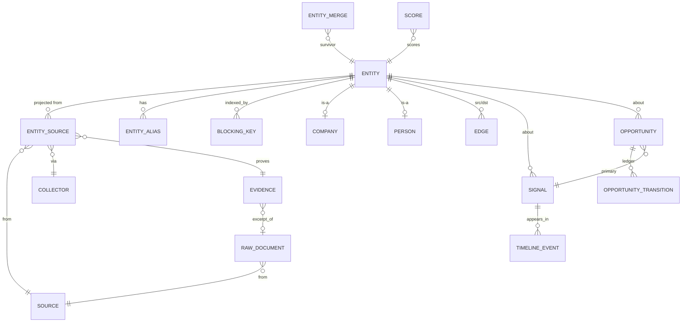

# 01 — Database Design Document

> **Master spec:** [`../ARCHITECTURE.md`](../ARCHITECTURE.md) §9 · Reference DDL: [`../schema/schema.sql`](../schema/schema.sql)
> **Status:** Implementation-ready · **DB:** PostgreSQL 16
> **Scope:** The canonical system-of-record. OpenSearch and the AGE graph are *derived, rebuildable projections* and are specified in docs 02 and 06.

---

## 1. Purpose & Design Invariants

This document is the authoritative, table-by-table design of the OIP relational store. It expands the reference model in `schema.sql` into a full data dictionary with rationale, constraints, indexes, partitioning, access patterns, and lifecycle policy.

Five invariants govern **every** decision below. If a change violates one, it is wrong:

| # | Invariant | Enforcement |
|---|---|---|
| **I1** | **Observation vs. Canonical separation.** Raw claims land in `*_source`; canonical entities are computed projections. | `entity_source` is append-only; `entity.attributes` is written only by the resolver. |
| **I2** | **No claim without evidence.** Every canonical attribute and edge references `evidence`. | CI invariant check; NOT NULL `evidence_id` on observations; `evidence_ids[]` non-empty on edges/signals. |
| **I3** | **Append-only where truth accretes.** Observations, evidence, transitions, audit are never updated/deleted. | No `UPDATE`/`DELETE` grants on those tables for app roles; only `INSERT`/`SELECT`. |
| **I4** | **Projections are recomputable.** Canonical entity state, scores, and indexes can be rebuilt from observations + evidence. | Deterministic survivorship; replay harness. |
| **I5** | **`entity.id` is the shard key; one writer per table.** | Repository layer enforces single-writer; id is a plain BIGINT surrogate, hashable. |

**Non-goals (v1):** no `tenant_id`, no auth tables, no billing. All are additive later (see §12 and blueprint §27).

---

## 2. Logical Data Model (domains)

Tables are grouped into eight logical domains. Ownership = the single module allowed to write the group (blueprint §7.3).

| Domain | Tables | Owner module | Write pattern |
|---|---|---|---|
| **Reference/Config** | `source`, `collector`, `industry`, `category`, `keyword`, `technology`, `scoring_config` | `catalog/config` | low-frequency, mutable |
| **Raw** | `raw_document` | `ingestion` | append-only, partitioned |
| **Evidence** | `evidence` | `extraction` | append-only, partitioned |
| **Entity core** | `entity`, `entity_source`, `entity_merge`, `entity_alias`, `blocking_key`, `resolution_review` | `entity-resolution` | obs append-only; canonical projection mutable |
| **Satellites** | `company`, `person`, `domain` | `entity-resolution` | projection (upsert) |
| **Graph** | `edge` | `graph` | idempotent upsert |
| **Signals/Opps** | `signal`, `timeline_event`, `opportunity`, `opportunity_transition` | `opportunity` | signals/timeline append; opportunity mutable; transitions append |
| **Scoring** | `score`, `score_history` | `scoring` | score upsert; history append |
| **Ops/Audit** | `crawl_state`, `job`, `pipeline_offset`, `audit_event` | various | mixed |

### 2.1 Entity-relationship overview



---

## 3. Data Dictionary (table-by-table)

For each table: purpose, columns (name · type · null · meaning), keys, invariants, and the access patterns that justify its indexes. Types follow `schema.sql`; only clarifications and rules beyond the DDL are added here.

### 3.1 `source` — catalog of data origins
Purpose: one row per logical origin (GitHub, Reddit, company web). Drives trust weighting in survivorship and scoring.

| Column | Type | Null | Meaning |
|---|---|---|---|
| id | BIGSERIAL PK | no | surrogate |
| slug | TEXT UQ | no | stable machine name |
| display_name | TEXT | no | UI label |
| trust_tier | source_trust | no | `official>verified_api>news>community>inferred` — feeds survivorship (§I2, doc 04) |
| base_url | TEXT | yes | root |
| config | JSONB | no | source-level settings |

Rules: `trust_tier` is the single source of "how much do we believe this origin"; changing it triggers no rewrite but affects *future* survivorship recomputes. Immutable `slug`.

### 3.2 `collector` — versioned extractors bound to a source
| Column | Type | Null | Meaning |
|---|---|---|---|
| id | BIGSERIAL PK | no | |
| source_id | FK→source | no | |
| slug | TEXT UQ | no | e.g. `github_issues` |
| version | TEXT | no | semver; part of extraction idempotency key |
| capabilities | JSONB | no | `{supports_incremental, needs_browser, auth_kind}` |
| cadence_hint | INTERVAL | yes | default crawl period |
| enabled | BOOL | no | scheduler gate |

Rules: `version` participates in the extractor idempotency key so a collector upgrade re-derives downstream without collisions (blueprint §18.2).

### 3.3 Reference tables `industry`, `category`, `keyword`, `technology`
Small, mutable dictionaries. `technology.aliases TEXT[]` and `keyword.term` back deterministic extraction and normalization (doc 03/04). `keyword.weight` and `enabled` are operator-tunable (Keyword Management page, doc 07).

### 3.4 `scoring_config` — runtime weights
Exactly **one** row with `active=true` (enforced by partial unique index below). `weights JSONB` holds `{w1..w7, decay_tau{by_signal_type}, thresholds{...}}`. Changing the active row triggers a background rescore (doc 05), never a redeploy.

```sql
CREATE UNIQUE INDEX scoring_config_one_active ON scoring_config ((active)) WHERE active;
```

### 3.5 `raw_document` — index over immutable S3 bytes (PARTITIONED)
The searchable index; bytes live in object storage keyed by `s3_key`. Never deleted (cold-tiered only).

| Column | Type | Null | Meaning |
|---|---|---|---|
| id | BIGSERIAL | no | part of composite PK |
| source_id, collector_id | FK | no | provenance |
| url | TEXT | no | fetched URL |
| s3_key | TEXT | no | `raw/{source}/{yyyy}/{mm}/{content_hash}` |
| content_hash | BYTEA | no | sha256(body); dedupe + idempotency (I3) |
| content_type | TEXT | yes | |
| http_status | INT | yes | |
| headers | JSONB | yes | ETag/Last-Modified captured for conditional GET |
| fetched_at | TIMESTAMPTZ | no | **partition key** |

PK `(id, fetched_at)` (partitioned tables require the partition column in PK/unique constraints). Access patterns → indexes: dedupe by `content_hash`; "latest fetch of URL" by `(url, fetched_at DESC)`.

### 3.6 `evidence` — the provenance spine (PARTITIONED, highest write volume)
Every canonical claim points here. Append-only (I3). Partitioned monthly by `observed_at`.

| Column | Type | Null | Meaning |
|---|---|---|---|
| id | BIGSERIAL | no | PK part |
| source_id, collector_id | FK | no | origin |
| raw_document_id | BIGINT | yes | soft link to raw (partition-crossing → not a hard FK) |
| url | TEXT | no | |
| content_hash | BYTEA | no | |
| claim_type | TEXT | no | `person.role`, `company.domain`, `signal.funding`… |
| claim | JSONB | no | structured claim payload |
| snippet | TEXT | yes | human-readable proof excerpt shown in UI |
| confidence | REAL | no | [0,1] extraction confidence |
| embedding | vector(1024) | yes | semantic recall (doc 06 search) |
| observed_at | TIMESTAMPTZ | no | **partition key** |

PK `(id, observed_at)`. **FK note:** because `raw_document` and `evidence` are both partitioned, `raw_document_id` is an *application-enforced* reference, not a DB FK (Postgres cannot FK into a partitioned table by non-partition-key). Integrity is guarded by the extractor and a nightly consistency check.

### 3.7 `entity` — canonical node
| Column | Type | Null | Meaning |
|---|---|---|---|
| id | BIGSERIAL PK | no | **shard key** (I5) |
| entity_type | entity_type | no | person/company/… |
| canonical_key | TEXT | yes | apex domain / resolved handle; UQ with type |
| display_name | TEXT | yes | |
| attributes | JSONB | no | survivorship projection incl. per-field `chosen_evidence_ids` and `alternatives[]` (doc 04 §survivorship) |
| status | entity_status | no | `active/merged/suppressed/tombstoned` |
| first_seen_at / last_seen_at | TIMESTAMPTZ | no | |
| version | BIGINT | no | bumped on every projection write → cache/index invalidation (blueprint §20) |

Constraints: `UNIQUE(entity_type, canonical_key)`. When two entities merge, the loser gets `status='merged'` and its `entity_source` rows are re-pointed to the survivor (lineage retained via `entity_merge`).

### 3.8 `entity_source` — append-only observations (I1)
Every collector assertion about an entity, pre-survivorship. Never updated except `entity_id` re-pointing on merge/un-merge (the one allowed mutation, itself audited).

| Column | Type | Null | Meaning |
|---|---|---|---|
| id | PK | no | |
| entity_id | FK→entity | no | current canonical owner |
| source_id, collector_id | FK | no | |
| external_id | TEXT | yes | id within the source (e.g., GitHub login) |
| raw_attributes | JSONB | no | as-observed |
| evidence_id | BIGINT | no | provenance (soft ref to partitioned evidence) |
| match_prob | REAL | yes | resolver's confidence this obs belongs here |
| observed_at | TIMESTAMPTZ | no | |

Indexes: `(entity_id, observed_at DESC)` for "rebuild this entity's projection"; `(source_id, external_id)` for "have we seen this source record before?" (dedupe/upsert).

### 3.9 `entity_merge` — reversible merge ledger
Audit of every merge with the decision features. `reversible=true` + retained observation lineage enable un-merge (doc 04 §un-merge). Append-only.

### 3.10 `entity_alias`, `blocking_key`, `resolution_review`
- `entity_alias` — "Acme"/"Acme Inc"/"Acme LLC"; trigram-indexed for fuzzy match.
- `blocking_key` — precomputed recall keys (apex domain, name soundex, handle); the *only* thing scanned during ER candidate generation, never all-pairs (doc 04 §blocking).
- `resolution_review` — human adjudication queue for `0.60 ≤ p < 0.90`; operator decisions become training labels.

### 3.11 Satellites `company`, `person`, `domain`
Hot, typed, indexable fields projected from `entity.attributes` for query performance (the dashboard filters on `company.primary_domain`, `person.current_company_id`, etc.). PK = `entity_id`. `intent_vector`/`bio_vector` mirror embeddings for in-DB kNN recall. `domain` is separate (a company owns many domains) with unique `host` and apex index.

### 3.12 `edge` — knowledge-graph relationships
Fully specified in doc 02. DB-relevant points: typed (`edge_type`), temporal (`valid_from/valid_to`), evidence-backed (`evidence_ids[]`), idempotent on `UNIQUE(src,dst,edge_type,valid_from)`, indexed both directions plus a partial index on current edges (`WHERE valid_to IS NULL`).

### 3.13 `signal`, `timeline_event`, `opportunity`, `opportunity_transition`
- `signal` — classified buying-intent events; `decayed_score` recomputed by the decay sweep (doc 05). Indexed by `(company_entity_id, signal_type, detected_at DESC)` and `(intent_axis, detected_at DESC)`.
- `timeline_event` — **partitioned monthly** by `occurred_at`; per-company chronology.
- `opportunity` — mutable projection; `UNIQUE(company_entity_id, template_id)` so one opportunity per (company, thesis); indexed by `(tier, opportunity_score DESC)` — the dashboard's primary access path.
- `opportunity_transition` — append-only promotion/demotion ledger (Bronze→Silver→Gold and back).

### 3.14 `score`, `score_history`
`score` holds the latest value per `(subject_kind, subject_id, score_type)` with a `components JSONB` breakdown for explainability. `score_history` is partitioned monthly, append-only, for trend charts and audits.

### 3.15 Ops/Audit `crawl_state`, `job`, `pipeline_offset`, `audit_event`
- `crawl_state` — per (collector, seed) checkpoint/cursor + ETag + `next_due` + `value_score` for the value×staleness scheduler (blueprint §19).
- `job` — collect/replay/backfill/rescore runs with status + trace_id.
- `pipeline_offset` — consumer-group offsets for replay control.
- `audit_event` — **never expired**; merges, un-merges, tier changes, config changes, erasures. Part of the asset (blueprint §23).

---

## 4. Constraints, Integrity & the FK Policy

1. **Hard FKs** within a partition-free relationship (e.g., `company.entity_id → entity.id`).
2. **Soft (application) references** wherever the target is a partitioned table (`evidence`, `raw_document`, `timeline_event`). Postgres cannot enforce these; the owning module enforces on write and a **nightly consistency job** flags orphans (an orphan evidence pointer is a data bug, alerted).
3. **Check constraints:** all score/confidence columns `CHECK (value BETWEEN 0 AND 1)`; `signal.strength`, `edge.confidence`, `evidence.confidence` likewise.
4. **Non-empty provenance:** `CHECK (cardinality(evidence_ids) > 0)` on `edge` and `signal` (enforces I2 at the DB).
5. **Enum discipline:** all controlled vocabularies are PG enums (cheap, indexable) with an ADR-gated process for adding values via migration.

---

## 5. Indexing Strategy (by access pattern)

Indexes exist to serve *named* queries, not speculatively. The catalog:

| Access pattern (who/where) | Index |
|---|---|
| Dashboard board: top opportunities by tier | `opportunity(tier, opportunity_score DESC)` |
| Company page: firmographic lookup by domain | `company(primary_domain)` partial unique |
| Company page: signals timeline | `signal(company_entity_id, signal_type, detected_at DESC)`, `timeline_event(company_entity_id, occurred_at DESC)` |
| Graph neighborhood (both directions) | `edge(src_entity_id, edge_type)`, `edge(dst_entity_id, edge_type)`, partial `edge(edge_type) WHERE valid_to IS NULL` |
| ER blocking (recall) | `blocking_key(key_type, key_value)` |
| ER fuzzy name | `entity USING GIN(display_name gin_trgm_ops)`, `entity_alias USING GIN(alias gin_trgm_ops)`, `person USING GIN(full_name gin_trgm_ops)` |
| Dedupe / idempotency | `raw_document(content_hash)`, `evidence(content_hash)`, `entity_source(source_id, external_id)` |
| Attribute filters (JSONB) | `entity USING GIN(attributes)`, `evidence USING GIN(claim)` |
| Semantic recall | HNSW on `evidence.embedding`, `company.intent_vector`, `person.bio_vector` (`vector_cosine_ops`) |
| Scheduler due-list | `crawl_state(next_due)` |
| Ops | `job(status, created_at DESC)`, `audit_event(action, created_at DESC)` |

**HNSW placement:** on partitioned `evidence`, build the vector index per-partition or maintain a compact `evidence_current` rollup for the hot window; kNN over the full 10B-row history is delegated to OpenSearch (doc 06), not Postgres.

---

## 6. Partitioning Strategy

**Partitioned by RANGE (month):** `raw_document(fetched_at)`, `evidence(observed_at)`, `timeline_event(occurred_at)`, `score_history(computed_at)`.

- **Why these four:** unbounded growth, time-correlated access, and cold-tierable. Everything else stays a normal table until a metric forces partitioning.
- **Automation:** a `maintenance` worker (blueprint §18.2) pre-creates the next 3 monthly partitions and, per retention policy, `DETACH`es partitions older than the hot window for cold storage — *never DROP* for raw/evidence.
- **Partition pruning:** all queries against these tables carry a time predicate (enforced by repository defaults) so the planner prunes.
- **Composite PK requirement:** partition key is included in PK/unique constraints (already in DDL).

Future sub-partitioning at extreme scale: hash sub-partitions on `hash(entity anchor)` within a month (declarative composite partitioning) — additive.

---

## 7. Growth Strategy

Scale ladder (blueprint §26); we climb only when a metric forces it:

1. **Vertical** — bigger managed Postgres until the hot working set approaches single-digit TB.
2. **Offload bytes** — already done: `raw_document` holds an index; bytes are in S3.
3. **Read replicas** — the serving/index projection load moves to replicas; primary handles writes.
4. **Cold tiering** — detach old monthly partitions to cheaper storage / Parquet-on-S3 for analytics (DuckDB/ClickHouse). The hot DB shrinks to the active window.
5. **Horizontal shard** — when single-primary write volume saturates, shard by `hash(entity_id)` (Citus or app-level). Feasible *because* `entity.id` is the designated shard key and every table is single-writer (I5).

Capacity model (order-of-magnitude at target): `evidence` dominates — 10B rows × ~1 KB ≈ 10 TB of index rows before compression; this is why evidence is partitioned and cold-tierable from day one, and why bytes never live in the row.

---

## 8. Retention Strategy

**Retention is a tiering policy, not a deletion policy** (blueprint §9.4). Hard rules:

| Data class | Policy |
|---|---|
| Raw bytes (S3), `raw_document`, `evidence`, `entity_source`, `*_transition`, `audit_event` | **Never deleted.** Hot → warm → cold tiering by age. This is the irreplaceable asset. |
| Derived projections: OpenSearch indices, AGE graph mirror, `score` (latest) | Rebuildable; may be dropped & rebuilt at will. |
| `score_history` | Retain hot 13 months for trends; cold-tier older. |
| Operational logs (Loki/OS) | Rotated 30–90 days (these are *not* evidence). |
| `job` rows | Prune succeeded > 90 days; keep failed/dead for forensics. |
| Cache (Redis) | TTL/version-keyed (blueprint §20). |

**Erasure (GDPR/CCPA readiness, blueprint §25):** a subject-erasure path tombstones the canonical entity (`status='tombstoned'`), purges that subject's raw bytes + evidence, and records the action in `audit_event`. This is the *only* sanctioned deletion of evidence, gated behind an operator action.

---

## 9. Key Access Patterns → Query Sketches

```sql
-- A. Dashboard: top Gold opportunities, freshest first
SELECT o.*, c.primary_domain
FROM opportunity o JOIN company c ON c.entity_id = o.company_entity_id
WHERE o.tier = 'gold' AND o.status = 'open'
ORDER BY o.opportunity_score DESC
LIMIT 50;                                   -- index: opportunity(tier, opportunity_score DESC)

-- B. Company detail: current signals + timeline (last 6 months)
SELECT * FROM signal
WHERE company_entity_id = $1 AND detected_at > now() - interval '180 days'
ORDER BY detected_at DESC;                   -- index: signal(company_entity_id, signal_type, detected_at DESC)

-- C. ER blocking: candidate companies sharing a blocking key
SELECT DISTINCT bk.entity_id
FROM blocking_key bk
WHERE (bk.key_type, bk.key_value) IN (('apex_domain','acme.com'),('name_soundex','A250'));

-- D. Provenance: rebuild an entity's projection inputs
SELECT es.raw_attributes, es.evidence_id, es.observed_at, s.trust_tier
FROM entity_source es JOIN source s ON s.id = es.source_id
WHERE es.entity_id = $1 ORDER BY es.observed_at;

-- E. Graph neighborhood (1 hop, current edges)
SELECT * FROM edge
WHERE src_entity_id = $1 AND valid_to IS NULL;   -- index: edge(src_entity_id, edge_type)
```

---

## 10. Concurrency, Transactions & Idempotency

- **Isolation:** default `READ COMMITTED`; ER merge and opportunity regeneration run in explicit transactions with `SELECT … FOR UPDATE` on the affected `entity`/`opportunity` rows to serialize concurrent updates to the same company (paired with per-entity partition ordering on the event bus, blueprint §14.5).
- **Idempotent upserts:** `INSERT … ON CONFLICT DO UPDATE` keyed on the natural keys (`entity(entity_type, canonical_key)`, `edge(src,dst,type,valid_from)`, `opportunity(company,template)`), so replays converge (I4, NFR-3).
- **Version bump:** every projection upsert increments `entity.version` in the same transaction, driving cache/index invalidation.
- **Advisory locks** for singleton maintenance (partition creation) to avoid duplicate DDL.

---

## 11. Migrations & Schema Evolution

- **Tooling:** Alembic; `docs/schema/schema.sql` is the *reference model*, migrations are the source of truth for prod DDL.
- **Rules:** every migration is reversible (`up`/`down`) and CI-tested both directions; enum additions and new columns are backward-compatible (add nullable/defaulted, backfill async, then constrain).
- **Zero-downtime pattern:** expand → migrate/backfill → contract. Never a blocking `ALTER` on a hot partitioned table without `CONCURRENTLY` index builds.
- **Data backfills** run as scheduled `job`s (replay harness), not inside migrations.

---

## 12. SaaS Readiness (additive, not now)

The multi-tenant migration (blueprint §27) touches this schema minimally and additively:
- `tenant_id` added **only** to *workspace* tables (saved searches, keyword sets, scoring configs, opportunity annotations) — the crawled graph (`entity`, `evidence`, `edge`, `signal`) stays **global and shared** (the moat).
- Postgres **Row-Level Security** policies scope workspace tables by `tenant_id`.
- No table is redesigned; the single-writer + entity-id-shard-key discipline means tenancy is a filter, not a rewrite.

---

## 13. Open Questions / ADR Backlog
- ADR-DB-1: Citus vs. app-level sharding when horizontal scale arrives (defer until write saturation).
- ADR-DB-2: keep AGE in the primary vs. move graph mirror to a replica (measure neighborhood latency at ~1B edges).
- ADR-DB-3: embedding dimension (1024 assumed) — pin to the chosen embedding model; migrating dim requires a vector column rebuild.
- ADR-DB-4: `evidence` sub-partitioning by hash within month — trigger threshold.
