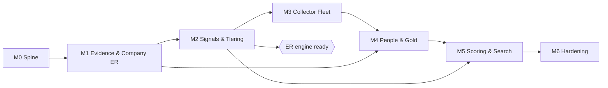

# 08 — Development Roadmap

> **Master spec:** [`../ARCHITECTURE.md`](../ARCHITECTURE.md) §29–30 · High-level plan: [`../ROADMAP.md`](../ROADMAP.md)
> **Status:** Implementation-ready
> **This document** turns the milestone summary into a sequenced, dependency-aware delivery plan across parallel workstreams, with entry/exit gates, risks, and resourcing. It is the bridge between the architecture and the backlog ([`10-implementation-tasks.md`](./10-implementation-tasks.md)).

---

## 1. Delivery Philosophy

1. **Thin vertical slices.** Every milestone takes a URL in and produces a scored, evidenced opportunity out — we prove the spine end-to-end early, then widen it. No milestone is a horizontal layer that only pays off later.
2. **Spine before breadth.** One collector + full pipeline before many collectors.
3. **Identity before signals.** Signals on unresolved/duplicated companies are worthless — ER correctness precedes signal richness.
4. **Useful by Month 2.** The operator has a self-upgrading board before automation and Gold arrive.
5. **Hardening is scheduled, not deferred.** Replayability and observability are product features here, with their own milestone.
6. **Every milestone has a demoable exit gate** — objective, not "we think it's done."

---

## 2. Workstreams

Six long-lived workstreams run in parallel; milestones coordinate them. Ownership assumes a small senior team (2–4) or a sequenced solo build.

| WS | Workstream | Owns (packages/apps) |
|---|---|---|
| **WS-P** | Platform & Infra | `core`, infra, CI/CD, migrations, observability |
| **WS-C** | Collection & Ingestion | `ingestion`, `collectors`, scheduler |
| **WS-X** | Extraction & Pipeline | `parsing`, `extraction`, `normalization`, `pipeline` |
| **WS-E** | Entity & Graph | `entities`, `graph` |
| **WS-O** | Opportunity & Scoring | `signals`, `opportunities`, `scoring` |
| **WS-S** | Serving (API, Search, UI) | `apps/api`, `search`, `apps/dashboard` |

---

## 3. Milestone Plan (M0–M6) with gates & dependencies

Legend: **Entry** = preconditions · **Exit** = demoable acceptance · **Crit path** = the dependency spine.

### M0 — Foundations / Spine (Month 1a)
**Goal:** prove the medallion spine end-to-end with one collector.
- **WS-P:** monorepo, `core` (EventBus iface + Redis Streams adapter, StageContext, DI, logging/tracing), docker-compose stack (PG16+AGE+pgvector, Redis, MinIO, OpenSearch, Temporal), Alembic from `schema.sql`, CI skeleton.
- **WS-C:** `ingestion` raw store (S3), fetch client (retry/backoff/robots/rate-limit), `company_web` collector, `raw.fetched` topic.
- **WS-X:** parser (HTML→ParsedDocument), deterministic extractor → Evidence, `documents.parsed`/`entities.candidate`.
- **WS-E:** minimal entity write (company) — resolution stubbed to domain-exact.
- **WS-S:** minimal API (`/opportunities`, `/companies/{id}`, `/evidence/{id}`) + dashboard board showing Bronze rows with evidence.
- **Crit path:** WS-P core → WS-C fetch → WS-X parse/evidence → WS-E entity → WS-S board.
- **Exit gate:** *a seeded company URL flows Raw→Parsed→Evidence→Entity→Bronze opportunity, visible in the dashboard with clickable evidence.*

### M1 — Evidence & Company ER (Month 1b)
**Goal:** enrich-never-replace + correct company identity.
- **WS-E:** full company ER — normalization, blocking, pairwise (rules v1), clustering w/ merge budget, survivorship, aliases, `entity_merge`, reversible un-merge; lineage endpoint.
- **WS-X:** evidence attached to every claim; consistency check job.
- **WS-P:** ER F1 eval harness + CI gate (baseline).
- **WS-S:** lineage drawer; provenance hover on firmographics.
- **Entry:** M0 exit. **Exit gate:** *two independent crawls of the same company merge into one canonical entity with correct survivorship; lineage view shows raw→canonical chain; ER F1 gate green.*

### M2 — Signals, Timeline, Tiering (Month 2)
**Goal:** first genuinely useful version.
- **WS-O:** signal classifiers (funding/hiring/tech/pain), timeline builder, opportunity templates (YAML), Gold/Silver/Bronze `classify()`, promotion/demotion ledger, decision-maker inference (Silver, rules).
- **WS-E:** graph builder emits `works_at`/`uses_tech`/`hiring_for`/`raised` edges + AGE mirror.
- **WS-S:** tier filter (Gold/Silver/Bronze/All), company detail + timeline + transitions.
- **Entry:** M1 exit. **Exit gate:** *a company with ≥2 signals promotes Bronze→Silver with a recorded transition; board filters by tier.*
- **Milestone value:** operator now has a filterable, self-upgrading board.

### M3 — Collector Fleet + Scheduler (Month 3)
**Goal:** the system feeds itself.
- **WS-C:** collector framework hardening (checkpoint/DLQ/incremental/browser pool); Temporal scheduler with per-source cadence + adaptive (value×staleness) + controlled seed expansion; collectors: careers, rss_blog, news, github, hackernews, reddit, producthunt, funding.
- **WS-P:** DLQ ops, pipeline-lag metrics, source-health alerts.
- **WS-S:** Collectors page + Jobs page + DLQ inspector.
- **Entry:** M2 exit (pipeline stable enough to feed many sources). **Exit gate:** *≥8 collectors run unattended daily via Temporal with retry/checkpoint/rate-limit/robots; new companies discovered without manual seeding.*

### M4 — People & Gold (Month 4)
**Goal:** top-tier product output.
- **WS-E:** person extraction + context-first person ER; `works_at` with relationship evidence; review queue.
- **WS-O:** Gold generation; refined decision-maker inference.
- **WS-S:** People pages; Review Queue page; person graph.
- **Entry:** M3 (rich multi-source data) + M1 (ER engine). **Exit gate:** *first Gold opportunities (person + role + company + domain + relationship evidence + signal); review queue operable.*

### M5 — Scoring, Search, Graph (Month 5)
**Goal:** ranking, retrieval, exploration.
- **WS-O:** full 8-score vector, runtime weights, decay sweep, score breakdown.
- **WS-S:** OpenSearch indices (companies/people/opportunities/evidence_text), hybrid + semantic search, faceted dashboard, graph explorer (AGE), Scoring page with live preview.
- **Entry:** M4 (signals/evidence/graph exist to rank & search). **Exit gate:** *"companies hiring SDR using HubSpot" returns ranked, evidence-backed results < 400 ms P95; score breakdown + graph explorer live.*

### M6 — Hardening & Scale-Readiness (Month 6)
**Goal:** trustworthy, unattended, ready for the next chapter.
- **WS-P:** partition automation, replay/backfill tooling, full monitoring/alerting (lag, data-quality, cost), load test at 10×.
- **WS-O:** daily digest; freshness SLA loop tuning.
- **WS-E:** ER F1 gate tightened; over-merge (reversal-rate) monitoring.
- **WS-S:** Keywords/Settings polish; digest surface.
- **Entry:** M5. **Exit gate:** *unattended, observable, replayable platform producing a daily flow of Gold/Silver/Bronze; passes 10× load test; ER F1 + parser golden + score-monotonicity gates green.*

---

## 4. Dependency Graph (milestone-level)

**Critical path:** M0→M1→M2→M4→M5→M6. M3 parallels M4's start (collectors feed people data) but is not strictly on the Gold critical path — people ER can begin on M2 data and widen as M3 lands.

---

## 5. Milestone Exit Criteria Matrix

| Milestone | Demoable exit | Quality gate |
|---|---|---|
| M0 | URL → Bronze opp with evidence | pipeline replay test passes |
| M1 | dup crawls merge; lineage visible | ER F1 ≥ baseline (CI) |
| M2 | Bronze→Silver transition; tier filter | tiering unit tests; template match tests |
| M3 | 8 collectors unattended daily | collector golden/politeness/recovery tests |
| M4 | first Gold with relationship evidence | person-ER F1 gate; review queue e2e |
| M5 | ranked hybrid search < 400 ms | score monotonicity + search relevance eval |
| M6 | unattended + observable + 10× load | all CI gates green; load SLOs met |

---

## 6. Cross-Cutting Tracks (run every milestone)
- **Observability:** each new worker/endpoint ships with metrics + traces + logs (Definition of Done).
- **Testing:** golden fixtures for every parser; contract tests for every event schema; ER eval maintained.
- **Cost control:** LLM budget metering from M2 (when extraction LLM path lands).
- **Docs/ADRs:** each open ADR (in specs) resolved as its decision arrives; CLAUDE.md kept current.
- **Data ethics:** robots/politeness + suppression path validated before M3 broadens crawling.

---

## 7. Risk-Adjusted Sequencing Notes
- **R1 (over-merge)** is front-loaded: M1 builds ER defensively with the F1 gate *before* M2 attaches signals that a wrong merge would corrupt.
- **R5 (false intent)** is mitigated at M2 (noisy-OR + min_signals) and hardened at M5 (score calibration) before scaling volume.
- **R2 (source fragility)** handled by golden tests + raw retention from M0, so M3's fleet expansion is safe.
- **R9 (over-engineering)** controlled by deferring Kafka/K8s/microservices past M6; v1 rides compose + managed stateful services.

---

## 8. Beyond 6 Months (stretch)
- Learned ranker (LambdaMART/GBM) + learned ER classifier from operator labels.
- Kafka/Redpanda backbone; Kubernetes + HPAs on consumer lag.
- Derived graph engine (Neo4j/Memgraph) if motif latency demands (ADR-KG-1).
- Multi-tenancy groundwork (blueprint §27): `tenant_id` on workspace tables, shared global graph, API-layer auth.
